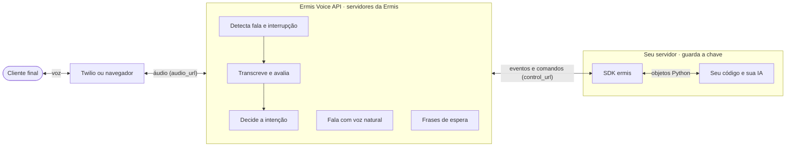
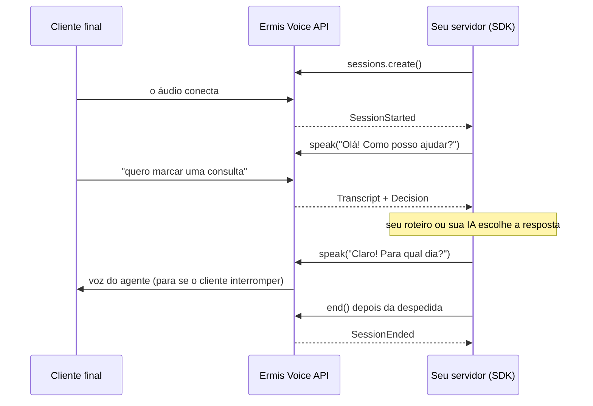

# Ermis Voice SDK para Python

[](https://github.com/Ermisai/ermis-voice-sdk/actions/workflows/ci.yml)

> **Prévia (0.2.0a1).** A Voice API ainda está em desenvolvimento; nomes e campos podem mudar até o lançamento.

O SDK liga o **seu backend** à **Ermis Voice API**. Ele cria sessões, abre o canal de controle e entrega os eventos da ligação como objetos Python, com métodos para mandar o agente agir.

**Novo por aqui?** O guia [Primeiros passos](https://github.com/Ermisai/ermis-voice-sdk/blob/main/docs/primeiros-passos.md) leva você da instalação a um número de telefone atendido pelo agente. No terceiro passo você já ouve o agente, sem telefone e sem navegador.

## Como funciona



São dois caminhos. O **áudio** vai do telefone (ou do navegador) direto para a Ermis e volta, sem passar pelo seu servidor. Os **eventos e comandos** ("o cliente disse X e quer Y", "fale Z") são os únicos que passam pelo SDK. Uma ligação é sempre o mesmo laço:



## O que é de quem

| | A **Voice API** (nos servidores da Ermis) | O **SDK** (no seu servidor) | **Você** |
|---|---|---|---|
| Áudio da ligação | Recebe do Twilio/navegador, detecta fala e interrupções | Não toca no áudio (exceto no transporte `websocket`, onde só repassa quadros) | Conecta o áudio à Ermis (TwiML, navegador) |
| O que o cliente disse | Transcreve e avalia (`transcript`, `assessment`) | Converte em `Transcript` | Decide o que fazer |
| O que o cliente quer | Classifica intenção, extrai dados (`decision`, `slot`) | `Decision`; `decide()` e `extract_slot()` viram chamadas com retorno | Usa para escolher a resposta |
| Resposta | Sintetiza e fala, para no barge-in | `speak()`, `say()` | Escreve o texto (seu roteiro ou sua IA) |
| Espera | Fala frases de espera e aplica o tempo limite | `WaitingOptions`, `thinking()` | Configura as frases |
| Cobrança | Mede por segundo, desconta créditos | `usage()`, `balance()`, exceções de crédito | — |

Resumindo: **a Voice API conduz a ligação; o SDK é o controle remoto; a inteligência do negócio é sua.** Tudo o que o SDK faz também pode ser feito com HTTP e WebSocket puros, seguindo a [documentação da API](https://github.com/Ermisai/ermis-voice-sdk/blob/main/docs/api.md). O SDK só tira o trabalho repetitivo: autenticação, montagem do JSON, ids de correlação, tipos, erros e o TwiML.

## Instalação

```bash
pip install ermis-voice    # Python 3.10+
export ERMIS_API_KEY=ek_test_...
```

O pacote se chama `ermis-voice` no pip e é importado como `ermis`:

```python
from ermis import Ermis
```

Para instalar direto do GitHub (por exemplo, uma versão ainda não publicada no PyPI):

```bash
pip install "git+https://github.com/Ermisai/ermis-voice-sdk.git"
```

Durante a prévia, a chave e a URL da Voice API são entregues pela equipe da Ermis. Defina `ERMIS_API_URL` se ela for diferente de `https://api.ermis.ai`.

Chaves `ek_test_…` usam o Sandbox; `ek_live_…`, produção. **Use a chave só no servidor.**

## Início rápido (Twilio)

```python
import asyncio

from fastapi import FastAPI, Form, Response
from ermis import Ermis, SessionStarted, Decision

app = FastAPI()
ermis = Ermis()  # lê ERMIS_API_KEY

@app.post("/twilio/voz")
async def ligacao(CallSid: str = Form(...)):
    session = await ermis.sessions.create(transport="twilio", metadata={"call_sid": CallSid})
    asyncio.create_task(conversar(session))
    return Response(session.twiml(), media_type="application/xml")   # o áudio vai direto para a Ermis

async def conversar(session):
    async with ermis.connect(session) as call:
        async for event in call:
            if isinstance(event, SessionStarted):
                await call.speak("Olá! Como posso ajudar?", calibrate=True)
            elif isinstance(event, Decision):
                await call.speak(await sua_ia(event))
```

Exemplo completo, com respostas rápidas, confirmação, desistência e despedida: [`examples/atendente_twilio.py`](https://github.com/Ermisai/ermis-voice-sdk/blob/main/examples/atendente_twilio.py).

## Exemplos

| Exemplo | O que mostra |
|---|---|
| [`primeira_ligacao.py`](https://github.com/Ermisai/ermis-voice-sdk/blob/main/examples/primeira_ligacao.py) | Fale com o agente sem telefone: envia um WAV gravado e salva a resposta em `resposta.wav` |
| [`atendente_twilio.py`](https://github.com/Ermisai/ermis-voice-sdk/blob/main/examples/atendente_twilio.py) | Atendente geral por telefone: frases prontas, sua IA, confirmação, desistência e despedida |
| [`agendamento.py`](https://github.com/Ermisai/ermis-voice-sdk/blob/main/examples/agendamento.py) | Marcar, remarcar e cancelar consultas: intenções do negócio, horários como opções faladas, nome e telefone ditados, confirmação |
| [`ura.py`](https://github.com/Ermisai/ermis-voice-sdk/blob/main/examples/ura.py) | URA por voz: o cliente diz o motivo e é transferido para financeiro, suporte ou vendas |

Os exemplos de telefone rodam com `uvicorn <arquivo>:app` e um número do Twilio; o passo a passo está em [Primeiros passos](https://github.com/Ermisai/ermis-voice-sdk/blob/main/docs/primeiros-passos.md#6-ligação-de-verdade-pelo-twilio).

## Referência

### `Ermis(api_key=None, *, base_url=None, timeout=10.0, http_client=None)`

Cliente assíncrono. Sem `api_key`, lê `ERMIS_API_KEY`; sem `base_url`, lê `ERMIS_API_URL` ou usa `https://api.ermis.ai`. Feche com `await ermis.aclose()` ou use `async with Ermis() as ermis`.

| Método | Chamada da API | Retorno |
|---|---|---|
| `await ermis.sessions.create(**opções)` | `POST /v1/voice/sessions` | `Session` |
| `await ermis.sessions.get(session_id)` | `GET /v1/voice/sessions/{id}` | `dict` |
| `await ermis.sessions.end(session_id)` | `DELETE /v1/voice/sessions/{id}` | `None` |
| `await ermis.usage(limit=50, before=None)` | `GET /v1/usage` | `dict` com `entries` e `next_cursor` |
| `await ermis.balance()` | `GET /v1/account/balance` | `dict` |
| `ermis.connect(session_or_control_url)` | WebSocket `control_url` | `Call` (use com `async with`) |

`usage()` devolve os lançamentos de crédito em páginas: passe o `next_cursor` recebido em `before` para buscar a página seguinte (`limit` de 1 a 100). `balance()` devolve `balance`, `reserved_credits` (reservado por ligações em andamento) e `available_credits`, em créditos inteiros.

**Opções de `sessions.create`** (todas opcionais; o que você não passar usa o padrão da API):
`transport` (`"twilio"`, `"browser"`, `"websocket"`), `audio_format` (`"mulaw_8k"`, `"pcm16_48k"`), `language`, `voice`, `auto_decide`, `transcription_priority` (`"balanced"`, `"latency"`, `"accuracy"`), `vad=VadOptions(min_silence_ms=…)`, `barge_in=BargeInOptions(enabled=…, min_speech_ms=…)`, `waiting=WaitingOptions(…)`, `max_duration_s`, `metadata`.

```python
from ermis import WaitingOptions

waiting = WaitingOptions(
    filler_after_ms=800,                       # None desliga a frase de espera
    filler_messages=["Certo, um momento."],
    filler_by_intent={"complaint": ["Entendo, sinto muito por isso."]},   # frase pela intenção da fala
    gap_after_ms=600,                          # pausa antes da sua resposta; None desliga
    patience_after_ms=3500,
    patience_every_ms=8000,
    patience_messages=["Ainda estou verificando…"],
    timeout_ms=20000,                          # None: espera sem limite
    timeout_message="Desculpe, não consegui essa informação agora.",
    timeout_action="apologize",                # ou "end"
)
```

### `Session`

`session_id`, `audio_url`, `control_url`, `session_token`, e:

- `session.twiml()`: TwiML pronto para o transporte `twilio`, com o token escapado.
- `session.browser_credentials()`: `{"audio_url", "session_token"}`, o que entregar ao navegador no transporte `browser`. A chave de API nunca sai do servidor.

### `Call`: o canal de controle

`async for event in call` recebe os eventos até `SessionEnded`. Os comandos podem ser chamados a qualquer momento, inclusive enquanto você trata um evento.

| Método | Mensagem enviada | Retorno |
|---|---|---|
| `await call.speak(text, *, voice=, allow_barge_in=, calibrate=, id=)` | `speak` | o `id` da fala, na hora |
| `await call.say(text, **mesmas_opções)` | `speak` e espera | `True` se falou tudo, `False` se o cliente interrompeu |
| `await call.interrupt()` | `interrupt` | — |
| `await call.decide(text, custom_intents=[CustomIntent(key, label, description)])` | `decide` | `Decision` |
| `await call.extract_slot(text, name, type="text", *, description=)` | `extract_slot` | `SlotResult` |
| `await call.thinking(message=None, *, timeout_ms=None)` | `thinking` | — |
| `await call.done_processing()` | `done_processing` | — |
| `await call.end()` | `end` | — |
| `await call.send_audio(frame)` | quadro binário (só `websocket`) | — |
| `await call.playback_finished(speak_id)` | `playback_finished` (só `websocket`) | — |
| `await call.send(dict)` | qualquer mensagem crua | — |

`decide()` e `extract_slot()` geram o `id`, esperam a resposta com esse `id` (padrão: 10 s) e devolvem o resultado. Essas respostas **não** aparecem na iteração. Depois do fim, `call.ended` guarda o `SessionEnded`.

### Eventos

| Classe | Evento da API | Campos |
|---|---|---|
| `SessionStarted` | `session.started` | `session_id`, `limits` |
| `SpeechStarted` / `SpeechEnded` | `speech.started` / `speech.ended` | `duration_ms` |
| `Transcript` | `transcript` | `utterance_id`, `text`, `uncertain`, `assessment`, `latency_ms` |
| `Decision` | `decision` | `intent`, `action`, `is_escape`, `complexity`, `custom_intent`, `extracted`, `utterance_id`, `id` |
| `SlotResult` | `slot` | `id`, `value`, `status`, `found` |
| `SpeakStarted` / `SpeakDone` | `speak.started` / `speak.done` | `id`, `chars` |
| `BargeIn` | `barge_in` | `id` |
| `WaitingSpoken` | `waiting` | `utterance_id`, `kind`, `text` |
| `ReplyTimeout` | `reply_timeout` | `utterance_id`, `action` |
| `Usage` | `usage` | `billed_seconds`, `credits`, `balance` |
| `WarningEvent` | `warning` | `code`, `message` |
| `ErrorEvent` | `error` | `code`, `message` |
| `SessionEnded` | `session.ended` | `reason`, `billed_seconds`, `credits` |
| `Audio` | quadro binário (só `websocket`) | `data` |
| `UnknownEvent` | qualquer outro | — |

Todo evento tem `type` e `raw` (o JSON original). Eventos novos da API chegam como `UnknownEvent` em vez de quebrar o seu código.

`Transcript.assessment` traz `ignore`, `ask_to_repeat`, `unproductive`, `confirm` e o atalho `usable` (nem `ignore`, nem `ask_to_repeat`, nem `unproductive`).

### Erros

O mesmo erro chega como status HTTP ou código de fechamento do WebSocket; o SDK levanta a mesma exceção nos dois casos. Todas herdam de `ErmisError` (`message`, `code`, `status`, `request_id`). Guarde o `request_id` para falar com o suporte.

| Exceção | HTTP / WebSocket |
|---|---|
| `AuthenticationError` | 401 / 4001 |
| `InsufficientCreditsError` | 402 / 4002 |
| `ChannelLimitError` | 429 / 4029 |
| `RateLimitError` | 429 com código `rate_limited` (muitas requisições em pouco tempo; tente de novo em instantes) |
| `InvalidRequestError` | 400 / 4400 (também quando `decide`/`extract_slot` recebem `error`) |
| `SessionTimeoutError` | 4008 (60 s sem áudio) |
| `MaxDurationError` | 4013 |
| `APIError` | 500 / 1011 |
| `ConnectionClosedError` | o canal fechou antes de `session.ended` |

## Outros transportes

**Navegador.** Crie a sessão com `transport="browser", audio_format="pcm16_48k"` e envie `session.browser_credentials()` ao navegador. O navegador abre `audio_url?session_token=…` e troca áudio direto com a Ermis; o seu backend conduz a conversa com `ermis.connect(session)`, como no Twilio.

**Seu próprio WebSocket.** Com `transport="websocket"`, o mesmo `Call` leva áudio e controle: envie com `call.send_audio(frame)`, receba `Audio` na iteração e avise o fim de cada fala com `call.playback_finished(speak_id)`.

## Documentação

- [Primeiros passos](https://github.com/Ermisai/ermis-voice-sdk/blob/main/docs/primeiros-passos.md): da instalação a uma ligação de verdade, com lista de conferência para produção.
- [Referência da Voice API](https://github.com/Ermisai/ermis-voice-sdk/blob/main/docs/api.md): sessões, canal de controle, decisões, mensagens de espera, áudio e erros.
- Na plataforma da Ermis: **Documentação API → Ermis Voice** e a aba **Ligação** da Área de Teste, para conversar com o agente pelo microfone.

## Desenvolvimento

```bash
uv venv && uv pip install -e ".[dev]"
.venv/bin/python -m pytest -q
```

Os testes rodam contra uma Voice API simulada (REST com `httpx.MockTransport`, controle com um servidor WebSocket local).

## Licença

MIT. Veja [LICENSE](https://github.com/Ermisai/ermis-voice-sdk/blob/main/LICENSE).
