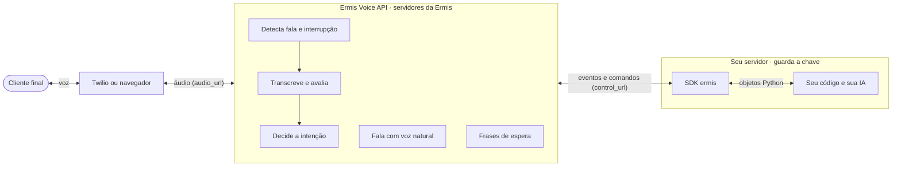
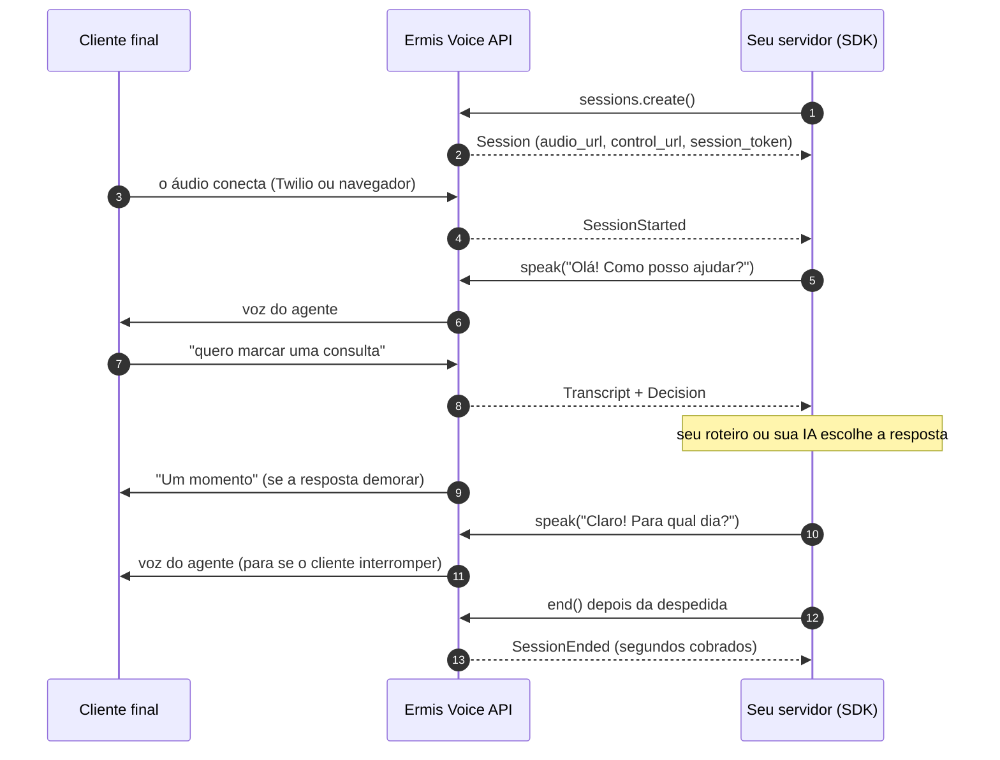

# Primeiros passos: do zero a uma ligação com o agente de voz

Este guia leva você da instalação até um atendente atendendo o telefone. Cada passo funciona sozinho: no passo 3 você confere a conexão e os créditos, e no passo 4 já ouve o agente, sem telefone e sem navegador.

Depois deste guia, os [tutoriais](tutoriais/README.md) montam agentes completos para cenários comuns: atendente, URA, agendamento, pedidos, assistente com IA e ligação ativa. O [tutorial do atendente](tutoriais/atendente.md) explica cada ajuste da configuração: nome e voz do agente, calibragem de ruído, qualidade e latência, respostas pré-definidas e a sua IA.

Se preferir que um assistente de IA escreva o primeiro agente, use o [prompt pronto](prompt-para-ia.md): descreva o seu negócio e receba o código com testes. Este guia continua útil para entender e ajustar o que ele gerar.

| Passo | O que você faz | Tempo |
|---|---|---|
| [1. Prepare o ambiente](#1-prepare-o-ambiente) | Python e a chave de API | 2 min |
| [2. Instale o SDK](#2-instale-o-sdk) | `pip install ermis-voice` | 1 min |
| [3. Teste a conexão e os créditos](#3-teste-a-conexão-e-os-créditos) | A chave, o endereço e o saldo, antes de tudo | 1 min |
| [4. Primeira ligação, sem telefone](#4-primeira-ligação-sem-telefone) | O hello world: um script fala com o agente e salva a resposta | 5 min |
| [5. Entenda o loop de eventos](#5-entenda-o-loop-de-eventos) | O que chega e o que responder | 5 min |
| [6. Coloque a sua lógica](#6-coloque-a-sua-lógica) | Roteiro, IA, dados ditados | — |
| [7. Ligação de verdade pelo Twilio](#7-ligação-de-verdade-pelo-twilio) | Um número de telefone atendido pelo agente | 15 min |
| [8. Ligação pelo navegador](#8-ligação-pelo-navegador) | Um botão "Ligar" no seu site | — |
| [9. Antes de ir para produção](#9-antes-de-ir-para-produção) | Lista de conferência | — |

## Como as peças se encaixam



O áudio nunca passa pelo seu servidor: ele vai do telefone (ou do navegador) direto para a Ermis. Pelo SDK passam só os eventos ("o cliente disse X e quer Y") e os comandos ("fale Z"). Quem escolhe a resposta é você.

## 1. Prepare o ambiente

- **Python 3.10 ou mais novo.** Confira com `python3 --version`. O macOS vem com o 3.9, e nele o `pip install ermis-voice` falha com *"No matching distribution found"*: instale um Python novo (python.org, `brew install python@3.12` ou `uv`).
- **Chave de API.** Crie na plataforma da Ermis ([app.ermis.ai](https://app.ermis.ai), página Tokens API), com acesso ao Ermis Voice. A chave fica **só no seu servidor**: nunca no navegador, no app ou no repositório.

```bash
export ERMIS_API_KEY="..."   # a chave de API da plataforma
```

O SDK usa a Voice API em `https://voice-api.live.ermis.ai`. Defina `ERMIS_API_URL` só se a equipe da Ermis indicar outro endereço. Até a versão 0.4.0a1, o endereço padrão do SDK era antigo e não responde mais: nessas versões, defina `export ERMIS_API_URL="https://voice-api.live.ermis.ai"` (ou atualize o SDK).

## 2. Instale o SDK

```bash
python3.12 -m venv .venv          # um ambiente só para o projeto
source .venv/bin/activate
pip install -U pip ermis-voice
python -c "import ermis; print(ermis.__version__)"   # 0.4.1a1 ou mais novo
```

O pacote se chama `ermis-voice` no pip e é importado como `ermis`.

## 3. Teste a conexão e os créditos

Antes da primeira ligação, confira que a chave, o endereço e a conta estão certos. O exemplo [`examples/checa_conexao.py`](../examples/checa_conexao.py) consulta o saldo e as vozes da conta:

```bash
curl -O https://raw.githubusercontent.com/Ermisai/ermis-voice-sdk/main/examples/checa_conexao.py
python checa_conexao.py
```

```text
SDK ermis-voice 0.4.1a1
Voice API: https://voice-api.live.ermis.ai
Vozes: Alex, Bruno, Carlos, Daniel, Eduardo, Felipe, Hugo, Igor, João, Sarah, Ana, Beatriz, ...
Créditos: 120 disponíveis (0 reservados em ligações)
Tudo certo: a conexão funciona. Próximo passo: python primeira_ligacao.py minha_fala.wav
```

O coração do script cabe em poucas linhas:

```python
async with Ermis() as ermis:          # lê ERMIS_API_KEY (e ERMIS_API_URL, se definido)
    saldo = await ermis.balance()     # confere a chave: available_credits, reserved_credits
    vozes = await ermis.voices.list() # as vozes da sua conta, a padrão primeiro
```

| Mensagem | Causa | O que fazer |
|---|---|---|
| `não foi possível conectar à Voice API em ...` ou `ConnectError` | Endereço errado ou sem rede | Confira `ERMIS_API_URL` (ou apague a variável para usar o padrão) e a sua conexão |
| `No matching distribution found for ermis-voice` | Python 3.9 ou mais antigo | Use o Python 3.10+ (passo 1) |
| `Chave recusada (401)` / `AuthenticationError` | Chave inválida, revogada ou com espaço sobrando | Copie de novo ou gere outra chave na plataforma |
| `Chave sem acesso ao Ermis Voice` (403, `product_not_allowed`) | A chave não tem o Ermis Voice, ou a conta não tem plano ativo | Gere a chave com acesso ao Ermis Voice; confira o plano |
| `Créditos: 0 disponíveis` / `InsufficientCreditsError` (402) | Conta sem créditos | Adicione créditos ou fale com a equipe da Ermis |
| `'Ermis' object has no attribute 'voices'` | SDK antigo (0.2) | `pip install -U ermis-voice` |

## 4. Primeira ligação, sem telefone

O exemplo [`examples/primeira_ligacao.py`](../examples/primeira_ligacao.py) faz o papel do telefone: envia uma fala gravada como se fosse o cliente, conduz a conversa e salva tudo o que o agente falou em `resposta.wav`.

1. Baixe o exemplo e grave uma frase curta em WAV, no celular ou no computador. Por exemplo: "quero a segunda via do boleto". No Mac, dá para gerar a fala no terminal:

```bash
curl -O https://raw.githubusercontent.com/Ermisai/ermis-voice-sdk/main/examples/primeira_ligacao.py
say -v Luciana -o minha_fala.aiff "Quero a segunda via do boleto"
afconvert -f WAVE -d LEI16@16000 minha_fala.aiff minha_fala.wav
```

2. Rode:

```bash
python primeira_ligacao.py minha_fala.wav
```

Você vai ver algo assim:

```text
sessão vs_8f2c1a
cliente: 'quero a segunda via do boleto'  (412 ms)
decisão: intent=question_service action=escalate encerrar=False
agente: 'Entendi: quero a segunda via do boleto. Vou verificar isso para você. Até logo!'
fim: client, 9 s cobrados
resposta.wav: 7.8 s com tudo o que o agente falou
```

3. Ouça `resposta.wav`: a saudação e a resposta do agente, na voz da Ermis.

Nesse exemplo, o seu código está todo na função `responder()`. Mude o texto, rode de novo e ouça a diferença.

## 5. Entenda o loop de eventos

Toda ligação é o mesmo laço: a Ermis manda eventos, o seu código responde com comandos.



| Evento | Quando chega | O que fazer |
|---|---|---|
| `SessionStarted` | O áudio conectou | Fale a saudação com `speak(..., calibrate=True)` |
| `Transcript` | O cliente terminou de falar | Se `assessment.ignore`, chame `done_processing()`. Se não for `usable`, peça para repetir. Se `confirm`, confirme o que entendeu |
| `Decision` | Logo depois do `Transcript` | Responda com `speak()`. Se `is_escape`, despeça-se (ou transfira) e chame `end()` |
| `SpeakDone` | O agente terminou uma fala | Útil para encerrar depois da despedida |
| `BargeIn` | O cliente interrompeu o agente | Nada: a Ermis já parou de falar e está ouvindo |
| `WaitingSpoken` | A Ermis falou uma frase de espera | Nada: é aviso |
| `SessionEnded` | A ligação acabou | Registre o que precisar |

## 6. Coloque a sua lógica

Três formas de escolher a resposta, que você pode misturar:

- **Frases prontas pela intenção.** `Decision.intent` já diz se é cumprimento, agradecimento, reclamação, pedido de atendente... Para `action == "respond"`, uma frase pronta é mais rápida que qualquer IA.
- **Intenções do seu negócio.** `await call.decide(texto, custom_intents=[CustomIntent("marcar", "Marcar consulta", "...")])` devolve a chave escolhida em `custom_intent`. É assim que o exemplo de URA escolhe o setor.
- **A sua IA.** Envie o histórico para o seu modelo e fale a resposta. Se demorar, a Ermis fala "Um momento" sozinha; se você sabe que vai demorar, avise com `await call.thinking("Vou consultar o seu pedido.")`.

Para dados ditados, use `extract_slot`: "maria arroba gmail ponto com" vira `maria@gmail.com`, "onze nove oito..." vira um telefone formatado.

```python
email = await call.extract_slot(texto, "email", type="email")
if email.found:
    await call.speak(f"Vou enviar para {email.value}. Está certo?")
```

Exemplos completos:

| Exemplo | O que mostra |
|---|---|
| [`atendente_twilio.py`](../examples/atendente_twilio.py) | Atendente geral: frases prontas, sua IA, confirmação, desistência, despedida |
| [`agendamento.py`](../examples/agendamento.py) | Marcar, remarcar e cancelar consultas: `decide` com intenções do negócio, horários como opções faladas, nome e telefone ditados, confirmação antes de gravar |
| [`clinica.py`](../examples/clinica.py) | O resultado do [tutorial](tutoriais/atendente.md): respostas prontas, URA e IA em camadas |
| [`assistente_ia.py`](../examples/assistente_ia.py) | Suporte conduzido pela sua IA, com ferramentas que consultam o seu sistema ([tutorial](tutoriais/assistente-ia.md)) |
| [`confirmacao.py`](../examples/confirmacao.py) | Ligação ativa: o agente liga e confirma a consulta ([tutorial](tutoriais/ligacao-ativa.md)) |
| [`ura.py`](../examples/ura.py) | URA por voz: o cliente diz o motivo e é transferido para o setor certo, com CPF pedido no financeiro |

## 7. Ligação de verdade pelo Twilio

1. Crie uma conta no [Twilio](https://www.twilio.com) e compre um número de telefone com voz.
2. Rode um dos exemplos no seu computador:

```bash
pip install ermis-voice fastapi uvicorn python-multipart
uvicorn agendamento:app --port 8000
```

3. Deixe a porta 8000 acessível pela internet com HTTPS, por exemplo com [ngrok](https://ngrok.com): `ngrok http 8000`. Anote o endereço `https://….ngrok-free.app`.
4. No console do Twilio, abra o número e, em **Voice Configuration → A call comes in**, escolha **Webhook**, método `POST`, com a URL `https://….ngrok-free.app/twilio/voz`.
5. Ligue para o número.

O que acontece: o Twilio chama `/twilio/voz`; o exemplo cria a sessão com `transport="twilio"`, responde com `session.twiml()` e abre o canal de controle. O Twilio manda o áudio direto para a Ermis; o seu servidor só conduz a conversa.

## 8. Ligação pelo navegador

Para um botão "Ligar" no seu site, o seu backend cria a sessão e entrega ao navegador **só** o `audio_url` e o `session_token`:

```python
@app.post("/ligar")
async def ligar():
    session = await ermis.sessions.create(transport="browser", audio_format="pcm16_48k")
    asyncio.create_task(conversar(session))   # a mesma conduzir() dos exemplos
    return session.browser_credentials()       # {"audio_url": ..., "session_token": ...}
```

O navegador abre `audio_url?session_token=…`, envia o microfone em quadros de μ-law 8 kHz de 20 ms (160 bytes), toca o áudio recebido (PCM16 48 kHz) e descarta a fila ao receber `{"type": "clear"}`. Ao receber `{"type": "audio.end", "id"}`, responda `{"type": "playback_finished", "id"}` quando a fala terminar de tocar. Peça o microfone com `echoCancellation: true`. Detalhes em [Conectando o áudio](api.md#conectando-o-áudio).

## 9. Antes de ir para produção

- [ ] A chave está só no servidor, em variável de ambiente ou cofre de segredos.
- [ ] Toda ligação termina: despedida seguida de `end()`, e um limite de tentativas quando o cliente não é entendido.
- [ ] `is_escape` com `intent == "request_human"` leva a uma pessoa de verdade (transferência no Twilio, como em `ura.py`).
- [ ] Mensagens de espera configuradas (`WaitingOptions`) se a sua IA leva mais de um segundo.
- [ ] Dados importantes (e-mail, CPF, data) são confirmados antes de gravar.
- [ ] `vad.min_silence_ms` ajustado ao seu público: 600 a 800 ms para quem dita números ou fala devagar.
- [ ] Erros tratados: `InsufficientCreditsError`, `ChannelLimitError`, `RateLimitError` e `ConnectionClosedError`. Guarde o `request_id` dos erros para o suporte.
- [ ] Testado com ligações reais do seu público, em celular e em ambiente com ruído.

Dúvidas sobre qualidade e latência: [perguntas frequentes](api.md#perguntas-frequentes-qualidade-e-latência).
