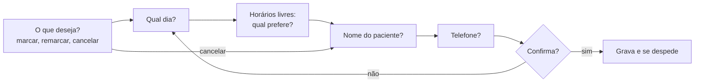

# Tutorial: agendamento por telefone

Um agente que marca, remarca e cancela consultas. É o cenário típico de **coleta de dados**: o agente precisa de várias informações (o que o cliente quer, o dia, o horário, o nome, o telefone), uma de cada vez, e tem de confirmar tudo antes de gravar.

Este tutorial segue [`examples/agendamento.py`](../../examples/agendamento.py). Para a configuração básica (Twilio, voz, ruído), veja o [tutorial do atendente](atendente.md).

## O que vamos construir



Uma etapa por pergunta. O código guarda em que etapa a conversa está e o que já foi coletado.

## 1. O pedido do cliente é uma intenção

```python
PEDIDOS = [
    CustomIntent("marcar", "Marcar consulta", "Agendar uma consulta nova"),
    CustomIntent("remarcar", "Remarcar consulta", "Mudar o dia ou o horário de uma consulta já marcada"),
    CustomIntent("cancelar", "Cancelar consulta", "Desmarcar uma consulta"),
]

SAUDACAO = "Olá! Você ligou para a Clínica Exemplo. Você quer marcar, remarcar ou cancelar uma consulta?"
```

Na sessão:

```python
session = await ermis.sessions.create(
    transport="twilio",
    voice="Sarah",
    custom_intents=PEDIDOS,               # cada Decision já traz marcar, remarcar ou cancelar
    vad={"min_silence_ms": 600},          # datas e telefones ditados têm pausas
    waiting=WaitingOptions(filler_after_ms=900),
    metadata={"call_sid": CallSid, "fluxo": "agendamento"},
)
```

O `min_silence_ms` de 600 ms (o padrão é 400) evita cortar o cliente no meio de "onze, nove, oito, sete...". É o principal ajuste de qualidade de um agendamento: veja [Qualidade e latência](atendente.md#5-qualidade-e-latência).

## 2. O que já foi coletado

Guarde o pedido numa estrutura, e a etapa numa variável:

```python
@dataclass
class Pedido:
    tipo: str = ""          # marcar | remarcar | cancelar
    dia: str = ""
    hora: str = ""
    hora_falada: str = ""
    nome: str = ""
    telefone: str = ""
    opcoes: list[CustomIntent] = field(default_factory=list)

pedido = Pedido()
etapa = "pedido"   # pedido -> dia -> hora -> nome -> telefone -> confirmar
```

Cada `Decision` é tratada conforme a etapa:

```python
elif isinstance(event, Decision) and not encerrando:
    texto = falas.get(event.utterance_id or "", "")
    if etapa == "pedido": ...
    elif etapa == "dia": ...
```

## 3. Dados ditados: `extract_slot` e `expect_slot`

Dia, nome e telefone são **dados**, não intenções. A Ermis interpreta o que foi dito e devolve o valor pronto:

| O cliente diz | Tipo | Valor |
|---|---|---|
| "sexta que vem" | `date` | a data |
| "é a Ana Paula Souza" | `name` | `Ana Paula Souza` |
| "onze nove nove oito sete..." | `phone` | o telefone formatado |
| "ana arroba gmail ponto com" | `email` | `ana@gmail.com` |

Há duas formas de pedir um dado:

- **`extract_slot(texto, nome, tipo)`** extrai o dado de uma fala que já chegou. Use para respostas curtas e claras, como o dia:

  ```python
  dia = await call.extract_slot(texto, "dia", "date")
  if not dia.found:
      await falar("Não peguei o dia. Pode dizer de novo? Por exemplo: amanhã, ou sexta-feira.")
      continue
  pedido.dia = dia.value
  ```

- **`expect_slot(nome, tipo)`**, chamado logo depois da pergunta, avisa que a próxima resposta traz o dado. A Ermis lê essa resposta também com o reconhecimento de maior precisão, em segundo plano, sem atrasar a conversa. Use para números longos, e-mails e endereços, onde a transcrição rápida mais erra:

  ```python
  await falar(f"Obrigada, {pedido.nome}. E um telefone para contato?")
  telefone_esperado = await call.expect_slot("telefone", "phone")
  ...
  # na Decision da resposta:
  telefone = await telefone_esperado
  ```

Quando o dado não vem (`found` falso), peça de novo com uma dica de como dizer: "Pode dizer devagar, com o DDD?".

## 4. Horários livres como opções faladas

Depois do dia, o agente consulta a agenda e oferece os horários livres. Avise antes que vai consultar, para o cliente não ficar no silêncio:

```python
await call.thinking("Vou ver a agenda, só um instante.")
pedido.opcoes = await horarios_livres(pedido.dia)
```

Cada horário é uma opção com o jeito de falar:

```python
async def horarios_livres(dia: str) -> list[CustomIntent]:
    return [
        CustomIntent("09:00", "nove da manhã", "9h, nove horas, de manhã cedo"),
        CustomIntent("14:00", "duas da tarde", "14h, duas horas, depois do almoço"),
        CustomIntent("16:30", "quatro e meia da tarde", "16h30, quatro e meia, fim da tarde"),
    ]
```

Troque as intenções da sessão pelos horários: a próxima `Decision` escolhe entre eles, mesmo com "o das duas", "depois do almoço" ou "o último":

```python
await call.set_custom_intents(pedido.opcoes)
await falar(f"Para {pedido.dia} eu tenho {nomes}. Qual prefere?")
...
# etapa "hora":
opcao = next((o for o in pedido.opcoes if o.key == event.business_intent()), None)
if opcao is None:
    await falar("Desculpe, qual desses horários você prefere?")
    continue
pedido.hora, pedido.hora_falada = opcao.key, opcao.label
await call.set_custom_intents(PEDIDOS)   # volta às intenções gerais
```

Outra forma é perguntar com `ask` e as opções como respostas esperadas: `await call.ask("Qual prefere?", choices=pedido.opcoes)`, e na `Decision` da resposta, `event.chosen()`. A pergunta vira a pergunta atual, e o `guard` a repete depois de uma fala confusa. Assim você não precisa trocar as intenções da sessão.

## 5. Confirme antes de gravar

Leia tudo de volta numa frase e espere o sim:

```python
def resumo(p: Pedido) -> str:
    if p.tipo == "cancelar":
        return f"Vou cancelar a consulta de {p.nome}, telefone {p.telefone}. Está certo?"
    acao = "remarcar a consulta" if p.tipo == "remarcar" else "marcar uma consulta"
    return f"Vou {acao} para {p.nome}, {p.dia}, às {p.hora_falada}. O telefone é {p.telefone}. Está certo?"
```

A voz lê o telefone em grupos e a data por extenso, sem você formatar nada.

Na resposta:

```python
if event.intent == "confirm_yes":
    await gravar_agendamento(pedido)
    await despedir(f"Consulta marcada! {DESPEDIDA}")
elif event.intent == "confirm_no":
    pedido = Pedido(tipo=pedido.tipo)
    etapa = "dia"
    await falar("Sem problemas, vamos de novo. Para qual dia você prefere?")
else:
    await falar("É só dizer sim ou não: está certo?")
```

Para sim ou não, você também pode usar `event.answer` (`"yes"`, `"no"` ou `None`). Ele lê a fala como resposta à pergunta que o agente fez: "isso mesmo, pode marcar" é `"yes"`, mesmo que a intenção da fala seja outra.

`gravar_agendamento()` é onde entra a sua agenda de verdade. Grave só depois do sim.

## 6. Cancelar pula etapas

Para cancelar, o agente não precisa de dia nem horário, só de quem é a consulta:

```python
if escolha == "cancelar":
    etapa = "nome"
    await falar("Certo. Qual é o nome do paciente?")
else:
    etapa = "dia"
    await falar("Claro! Para qual dia você prefere?")
```

## Variações

- **Paciente já cadastrado.** Se o número de quem liga (o `From` do Twilio) está no seu cadastro, pule nome e telefone e confirme: "Falo com a Ana?".
- **Especialidade ou médico.** Acrescente uma etapa com `ask("Qual especialidade?", choices=[...])` antes do dia. Para nomes de médicos, coloque-os também em `vocabulary`, para a transcrição já chegar com o nome certo.
- **Dúvidas no meio do agendamento.** "Vocês aceitam Unimed?" na etapa do dia não é um dia. Inclua essas perguntas como intenções, responda com a frase pronta e repita a pergunta da etapa. O [tutorial de pedidos](pedidos.md) mostra esse padrão.
- **Lembrete na véspera.** O [tutorial de ligação ativa](ligacao-ativa.md) liga para o paciente e confirma a consulta.

## Teste

`test_scheduling_books_an_appointment` e `test_scheduling_cancel_and_goodbye` em [`tests/test_example_flows.py`](../../tests/test_example_flows.py) rodam um agendamento completo e um cancelamento contra a Voice API simulada:

```bash
python -m pytest tests/test_example_flows.py -q -k scheduling
```
