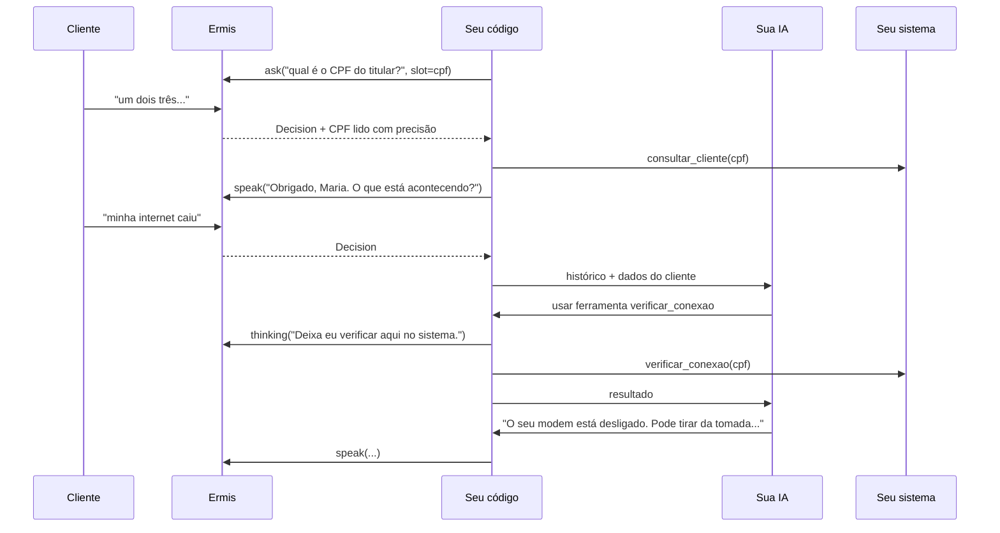

# Tutorial: assistente conduzido pela IA

Nos outros tutoriais, o roteiro é do seu código e a IA só responde o que sobra. Aqui é o contrário: num **suporte técnico**, cada conversa é diferente ("a internet caiu", "o wi-fi não chega no quarto", "está lento só à noite"), e um roteiro fixo não dá conta. A sua IA externa (camada 3) conduz o atendimento e consulta o seu sistema por **ferramentas**.

O código continua dono do que precisa ser sempre igual: identificar o cliente, encerrar e transferir. A Ermis continua dona do áudio, da fala confusa e do silêncio.

Este tutorial segue [`examples/assistente_ia.py`](../../examples/assistente_ia.py), o suporte da fictícia **Conecta Internet**. Para a configuração básica (Twilio, voz, ruído), veja o [tutorial do atendente](atendente.md).

## O que vamos construir



## 1. Quem faz o quê

| Parte | Quem cuida | Por quê |
|---|---|---|
| Fala confusa, cliente calado | A Ermis (`guard`) | Não depende do assunto: "pode repetir?" é sempre igual |
| Divagação e assunto fora do tema | A IA (`drift` e `off_topic` vazios) | A IA sabe em que ponto do atendimento está e volta ao assunto com naturalidade |
| Identificar o cliente | O seu código | É sempre igual, e decide quais dados a IA pode ver |
| Despedida e pedido de atendente | O seu código (`is_escape`) | Uma frase fixa é mais rápida e nunca falha |
| Diagnóstico, orientação, chamado | A IA, com ferramentas | Cada conversa é diferente |

Na sessão:

```python
guard={
    "enabled": True,
    "repeat": "Desculpe, não entendi. Pode repetir?",
    "steer": "Vamos voltar ao seu atendimento?",
    "drift": "",       # vazio: a divagação vai para a IA, que conhece o contexto
    "off_topic": "",   # vazio: o assunto fora do tema também
    "give_up": "Estou com dificuldade para te ouvir. Por favor, ligue de novo.",
    "no_reply": "Você ainda está aí?",
    "no_reply_give_up": "Como não ouvi resposta, vou encerrar. Até mais!",
},
waiting=WaitingOptions(filler_after_ms=1000, timeout_ms=30000),   # consultar o sistema leva alguns segundos
```

## 2. Identifique o cliente no código

A saudação já pede o CPF, com `slot`: a Ermis lê a resposta também com o reconhecimento de maior precisão, e o valor chega formatado:

```python
SAUDACAO = f"Olá! Aqui é o {NOME_AGENTE}, do suporte da {EMPRESA}. Para começar, qual é o CPF do titular?"

async def perguntar_cpf(texto: str, **opcoes) -> None:
    nonlocal cpf_pedido
    pergunta = await call.ask(texto, slot=("cpf", "cpf"), **opcoes)
    cpf_pedido = pergunta.value
```

Na `Decision` da resposta, o código busca o cadastro e só então passa a conversa para a IA:

```python
if not cpf:
    resultado = await cpf_pedido
    if not resultado.found:
        ...                                   # pede de novo; na segunda falha, transfere
    cpf = resultado.value
    await call.thinking("Só um instante, vou localizar o seu cadastro.")
    cliente = await consultar_cliente(cpf)
    await falar(f"Obrigado, {cliente['nome']}. Me conta: o que está acontecendo com a sua internet?")
```

Por que no código, e não na IA? Porque o CPF decide **o que a IA pode ver**. As ferramentas recebem o CPF do código, não da IA: a IA nunca consulta os dados de outro cliente, por mais que alguém tente convencê-la.

## 3. O prompt do agente

```python
PROMPT_IA = f"""Você é {NOME_AGENTE}, atendente de suporte técnico da {EMPRESA}, numa ligação telefônica.
O cliente já foi identificado; os dados dele vêm na primeira mensagem.
Como atender:
- Entenda o problema, consulte a conexão com a ferramenta antes de dar qualquer diagnóstico e oriente um passo
  por vez (por exemplo, desligar o modem da tomada por trinta segundos).
- Se o problema continuar depois das orientações, abra um chamado e informe o protocolo e a visita.
- Responda em português do Brasil, em uma ou duas frases curtas: o cliente ouve, não lê. Sem listas nem markdown.
- Não fale de assuntos fora do suporte: diga com gentileza que aqui você cuida da internet e volte ao problema.
- Se o cliente pedir uma pessoa, ou o problema for de cobrança, termine a resposta com [TRANSFERIR].
- Quando o atendimento terminar e o cliente se despedir, termine a resposta com [FIM]."""
```

Num atendimento por voz:

- **Um passo por vez.** O cliente não consegue reler uma lista de cinco passos. A IA orienta um, espera o cliente fazer e continua.
- **Diagnóstico com dados.** "Consulte a conexão antes de dar qualquer diagnóstico" evita a IA chutar a causa.
- **Saídas marcadas.** `[TRANSFERIR]` e `[FIM]` são lidas pelo código, que tira a marca do texto e age.

## 4. Ferramentas: a IA consulta o seu sistema

Descreva cada consulta como uma ferramenta. A descrição diz **quando** usar:

```python
FERRAMENTAS = [
    {
        "name": "verificar_conexao",
        "description": "Estado do modem e se há falha na região do cliente. Use antes de qualquer diagnóstico.",
        "input_schema": {"type": "object", "properties": {}, "additionalProperties": False},
        "strict": True,
    },
    {
        "name": "abrir_chamado",
        "description": "Abre um chamado técnico com visita. Use só depois de tentar as orientações por telefone.",
        "input_schema": {
            "type": "object",
            "properties": {"descricao": {"type": "string", "description": "O problema, em uma frase"}},
            "required": ["descricao"],
            "additionalProperties": False,
        },
        "strict": True,
    },
]
```

`verificar_conexao` não tem parâmetros: o CPF vem do código (passo 2).

A cada fala do cliente, o código chama a IA. Se ela pedir uma ferramenta, o código avisa o cliente, executa e devolve o resultado, até a IA ter a resposta:

```python
for _ in range(4):   # algumas consultas por resposta, no máximo
    resposta = await ia.beta.messages.create(
        model="claude-opus-5-5",
        max_tokens=2048,
        output_config={"effort": "low"},
        betas=["server-side-fallback-2026-07-01"],
        fallbacks="default",
        system=PROMPT_IA,
        tools=FERRAMENTAS,
        messages=mensagens,
    )
    if resposta.stop_reason != "tool_use":
        break
    await avisar("Deixa eu verificar aqui no sistema.")   # call.thinking(): o cliente não fica no silêncio
    mensagens.append({"role": "assistant", "content": resposta.content})
    resultados = []
    for bloco in resposta.content:
        if bloco.type == "tool_use":
            saida = json.dumps(await executar_ferramenta(bloco.name, bloco.input, cpf), ensure_ascii=False)
            resultados.append({"type": "tool_result", "tool_use_id": bloco.id, "content": saida})
    mensagens.append({"role": "user", "content": resultados})
```

- **Avise antes de consultar.** `call.thinking()` fala a frase na hora, e as frases de paciência do `waiting` continuam se a consulta demorar.
- **Limite as voltas.** Se a IA pedir ferramentas demais numa resposta, o exemplo transfere para um técnico.
- **Erros vão para a IA.** No exemplo, uma ferramenta que falha devolve o erro com `"is_error": True`, e a IA explica ao cliente ou transfere.
- O exemplo usa o Claude, pelo SDK da Anthropic, mas qualquer modelo com ferramentas serve: troque o corpo de `responder_com_ia()`.

## 5. O laço da conversa

```python
elif isinstance(event, Decision) and destino is None:
    if event.handled:            # camada 1: a Ermis já respondeu
        continue
    if event.is_escape:          # despedida ou pedido de uma pessoa: sempre igual, sem a IA
        ...
    if not cpf:                  # camada 2: identificação
        ...
    resposta = await responder_com_ia(historico, cliente, cpf, avisar)   # camada 3
    for marca, fim in ((MARCA_TRANSFERIR, "tecnico"), (MARCA_FIM, "fim")):
        if marca in resposta:
            resposta, destino = resposta.replace(marca, "").strip(), fim
    await falar(resposta, allow_barge_in=destino is None)
```

Depois da última fala (`SpeakDone`), o código transfere ou encerra, como nos outros tutoriais.

## 6. Latência

A IA é a parte mais lenta da conversa, e uma consulta ao sistema soma mais alguns segundos. O exemplo ajuda de quatro formas:

1. `effort: "low"` e respostas curtas no prompt.
2. `thinking()` antes de cada consulta, para o cliente ouvir que o agente está trabalhando.
3. `timeout_ms=30000` no `waiting`: mais tempo que o padrão (20 s), porque há consultas.
4. Despedida e transferência sem passar pela IA.

Se a demora ainda incomoda, meça onde está o tempo antes de mudar o modelo: no seu sistema, no modelo ou na quantidade de voltas de ferramentas.

## Teste

`test_support_identifies_the_customer_and_hands_over_to_the_ai` em [`tests/test_example_flows.py`](../../tests/test_example_flows.py) troca a IA por uma função de teste e confere o fluxo: o CPF lido com precisão, o cadastro passado para a IA, o aviso durante a consulta e a transferência quando a IA pede.

```bash
python -m pytest tests/test_example_flows.py -q -k support
```

Para testar a própria IA (se o diagnóstico está certo, se ela segue um passo por vez), monte um conjunto de conversas de exemplo e rode `responder_com_ia()` direto, sem ligação.
