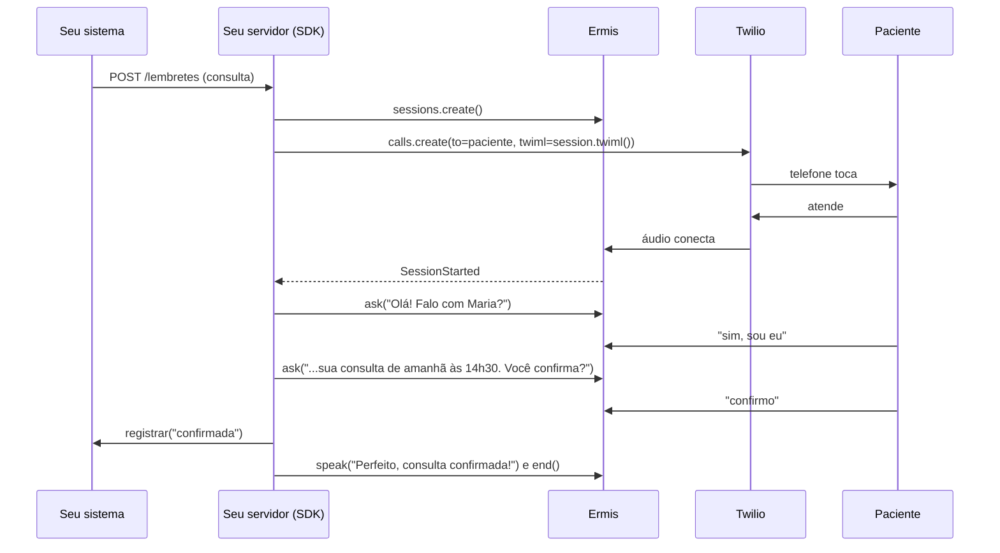

# Tutorial: ligação ativa (o agente liga para o cliente)

Nos outros tutoriais, o cliente liga. Aqui é o agente que liga: para confirmar uma consulta na véspera, lembrar um vencimento ou fazer uma pesquisa de satisfação. A conversa é curta, tem um objetivo só e termina com um resultado que o seu sistema registra.

Este tutorial segue [`examples/confirmacao.py`](../../examples/confirmacao.py): a Lia, da Clínica Bem Estar, liga para os pacientes de amanhã e confirma a consulta. Para a configuração básica (voz, ruído), veja o [tutorial do atendente](atendente.md).

## O que vamos construir



## 1. Disparar a ligação

A única diferença técnica para uma ligação recebida é quem começa. Em vez de o Twilio chamar o seu webhook, o seu servidor cria a sessão e pede ao Twilio para discar, com o TwiML da sessão:

```python
@app.post("/lembretes")
async def lembrar(consulta: Consulta) -> dict[str, str]:
    session = await ermis.sessions.create(transport="twilio", voice="woman", ...)
    asyncio.create_task(_rodar(session, consulta))      # a conversa espera o paciente atender
    await discar(consulta.telefone, session.twiml())
    return {"session_id": session.session_id}
```

Com o SDK do Twilio (`pip install twilio`):

```python
import os
from twilio.rest import Client

async def discar(telefone: str, twiml: str) -> None:
    await asyncio.to_thread(
        Client().calls.create, to=telefone, from_=os.environ["TWILIO_NUMERO"], twiml=twiml, timeout=30
    )
```

- O Twilio liga para o paciente e, quando ele atende, manda o áudio para a Ermis. Só então chega `SessionStarted`.
- **A sessão espera o áudio por até 60 s.** Por isso, crie a sessão logo antes de discar, e limite o tempo chamando (`timeout=30`). Se ninguém atende, a sessão termina sozinha (`SessionEnded`), e o exemplo registra `sem_resposta`.
- Para distinguir uma caixa postal de uma pessoa, o Twilio tem detecção de secretária eletrônica; veja a documentação dele.

## 2. Quem atende fala primeiro

Numa ligação recebida, o agente cumprimenta e o cliente responde. Numa ligação ativa, quem atende diz "alô?" e espera. A saudação precisa ser curta e confirmar com quem o agente fala:

```python
if isinstance(event, SessionStarted):
    await call.ask(f"Olá! Falo com {consulta.paciente}?", calibrate=True)
```

**Confirme a identidade antes de qualquer detalhe.** O agente só fala da consulta (especialidade, data) depois que a pessoa confirma que é o paciente. Quem atende pode ser outra pessoa da casa, e dados de saúde são dados sensíveis.

```python
if etapa == "identidade":
    if event.answer == "no" or event.is_escape:
        await finalizar("engano")
    elif event.answer == "yes" or event.intent == "name_provide":   # "sim, sou eu", "é a Maria"
        etapa = "lembrete"
        await call.ask(
            f"Aqui é a {NOME_AGENTE}, da {EMPRESA}. Estou ligando para lembrar da sua consulta de "
            f"{consulta.especialidade}, {consulta.quando}. Você confirma a sua presença?"
        )
    else:
        await call.ask(f"Desculpe, eu falo com {consulta.paciente}?")
```

## 3. As respostas possíveis

O paciente pode confirmar, cancelar ou querer remarcar, e diz isso de muitos jeitos: "pode deixar, eu vou", "não vou conseguir", "tem como ser na sexta?". Liste as respostas como intenções da sessão:

```python
RESPOSTAS = [
    CustomIntent("confirmar", "Confirma", "vai comparecer, está confirmado, pode deixar"),
    CustomIntent("cancelar", "Cancela", "não vai, quer desmarcar, não precisa mais"),
    CustomIntent("remarcar", "Remarca", "não pode nesse dia ou horário, quer outro dia"),
]
```

E combine com `event.answer`, o sim ou não da fala como resposta à pergunta do agente:

```python
elif etapa == "lembrete":
    if escolha in ("cancelar", "remarcar"):
        await finalizar("cancelada" if escolha == "cancelar" else "remarcar")
    elif escolha == "confirmar" or event.answer == "yes":
        await finalizar("confirmada")
    elif event.answer == "no":                 # "não vou poder": cancelar ou remarcar?
        etapa = "motivo"
        await call.ask("Tudo bem. Você prefere cancelar ou remarcar para outro dia?")
    else:
        await call.ask(f"Só para eu anotar: você vai à consulta {consulta.quando}?")
```

Um "não" sozinho não diz se a pessoa quer cancelar ou remarcar. Por isso, o agente pergunta em vez de escolher por ela.

## 4. Registrar o resultado

Toda ligação termina com um resultado para o seu sistema, mesmo as que não deram certo:

| Resultado | Quando |
|---|---|
| `confirmada` | O paciente confirmou |
| `cancelada` | O paciente cancelou |
| `remarcar` | O paciente quer outro horário (a recepção liga de volta) |
| `engano` | Quem atendeu não é o paciente |
| `sem_resposta` | Ninguém atendeu, desligou antes de responder ou ficou em silêncio |

```python
async def finalizar(chave: str) -> None:
    nonlocal resultado
    resultado = chave
    await registrar(consulta, chave)
    await call.speak(FINAIS[chave], allow_barge_in=False)
...
elif isinstance(event, SessionEnded):
    if resultado is None:        # desligou antes de responder, ou ninguém atendeu
        await registrar(consulta, "sem_resposta")
```

Remarcar por telefone é uma conversa mais longa (veja o [tutorial de agendamento](agendamento.md)). Num lembrete, é mais simples registrar o pedido e deixar a recepção retornar.

## 5. Silêncio e desvios

O `guard` cuida da fala confusa e do assunto fora do tema. Para o silêncio, o exemplo pede para ser avisado em vez de deixar a Ermis encerrar, para registrar o resultado:

```python
guard={
    "enabled": True,
    "repeat": "Desculpe, não entendi. Pode repetir?",
    "steer": "Só para eu anotar:",
    "drift": "Entendi!",
    "off_topic": f"Isso a recepção pode te ajudar, no {RECEPCAO}.",
    "give_up": f"Estou com dificuldade para te ouvir. Se precisar, ligue para {RECEPCAO}. Até logo!",
    "no_reply": "Alô? Você está me ouvindo?",
    "on_no_reply": "notify",     # no último silêncio, o código decide
},
max_duration_s=180,              # um lembrete é curto
```

```python
elif isinstance(event, NoReply) and not event.handled and resultado is None:
    resultado = "sem_resposta"
    await registrar(consulta, resultado)
    await call.speak(f"Não consegui te ouvir. Se precisar, ligue para {RECEPCAO}. Até logo!")
```

## 6. Várias ligações

Para ligar para todos os pacientes de amanhã, chame `/lembretes` para cada consulta, respeitando o número de canais do seu plano. Cada ligação ocupa um canal; acima do limite, `sessions.create` levanta `ChannelLimitError`. Um semáforo limita quantas ligações acontecem ao mesmo tempo:

```python
canais = asyncio.Semaphore(5)    # o número de canais do seu plano

async def lembrar_todos(consultas: list[Consulta]) -> None:
    async def uma(consulta: Consulta) -> None:
        async with canais:
            session = await ermis.sessions.create(...)
            await discar(consulta.telefone, session.twiml())
            async with ermis.connect(session) as call:
                await conduzir(call, consulta)   # o canal só é liberado quando a ligação termina
    await asyncio.gather(*(uma(c) for c in consultas))
```

Antes de disparar:

- **Ligue em horário comercial** e respeite as regras de contato com o consumidor e as listas de "não perturbe".
- **Use um número de saída reconhecível**, de preferência o mesmo da clínica.
- **Confira o saldo** com `await ermis.balance()` antes de um lote grande: cada ligação consome créditos.

## Teste

`test_outbound_reminder_is_confirmed`, `test_outbound_reminder_asks_to_reschedule` e `test_outbound_reminder_wrong_person` em [`tests/test_example_flows.py`](../../tests/test_example_flows.py) rodam as três conversas contra a Voice API simulada:

```bash
python -m pytest tests/test_example_flows.py -q -k outbound
```

Outros usos com a mesma estrutura: lembrete de vencimento (a confirmação vira "já pagou?" e a resposta "não" oferece a segunda via), pesquisa de satisfação (uma nota de 0 a 10 com `extract_slot(texto, "nota", "number")`) e aviso de entrega.
