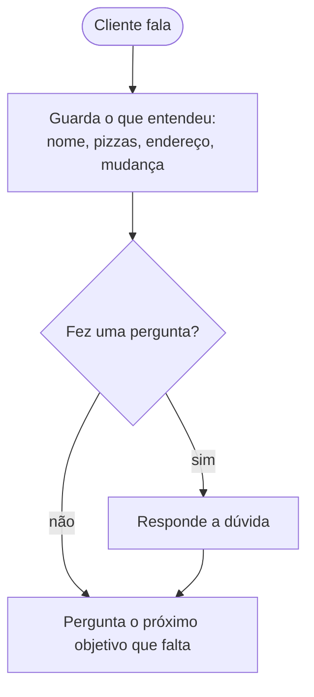

# Tutorial: pedidos por telefone

Uma pizzaria que recebe pedidos por telefone. É o cenário mais solto dos tutoriais: o cliente não segue a ordem das perguntas. Ele pede a pizza junto com o nome, pergunta o preço no meio do pedido, troca o sabor ("não, de calabresa não, quero quatro queijos") e muda o endereço na hora de confirmar.

Este tutorial segue [`examples/pizzaria.py`](../../examples/pizzaria.py). Para a configuração básica (Twilio, voz, ruído), veja o [tutorial do atendente](atendente.md).

## O que vamos construir

Em vez de uma sequência fixa de etapas, como no [agendamento](agendamento.md), o agente trabalha por **objetivos**: ele sabe o que precisa (nome, pizzas com tamanho e sabor, endereço, confirmação) e, a cada fala, guarda o que entendeu e pergunta só o que ainda falta.



## 1. O cardápio no vocabulário

O reconhecimento de fala conhece o português do dia a dia, mas não o seu cardápio. Liste os sabores e tamanhos em `vocabulary`: quando a transcrição sai parecida pelo som ("marquerita", "carabeça"), o texto já chega corrigido ("margherita", "calabresa"):

```python
VOCABULARIO = [
    "quatro queijos", "frango com catupiry", "frango", "catupiry", "calabresa", "mussarela", "margherita",
    "portuguesa", "pepperoni", "chocolate", "brigadeiro", "pequena", "média", "grande", "família", "broto",
]
```

`Transcript.corrections` mostra o que foi ajustado, útil para conferir nos registros. Use as palavras que o cliente fala, não códigos internos.

## 2. As intenções: pedir, mudar e perguntar

```python
INTENCOES = [
    CustomIntent("perguntar_cardapio", "Pergunta sobre o cardápio", "quais sabores existem, se tem pizza doce"),
    CustomIntent("perguntar_preco", "Pergunta de preço", "quanto custa uma pizza, quanto fica o pedido"),
    CustomIntent("perguntar_entrega", "Pergunta sobre a entrega", "tempo de entrega, taxa, área de entrega"),
    CustomIntent("pedir_pizza", "Pede pizza", "diz tamanho, sabor ou quantidade de pizza que quer"),
    CustomIntent("mudar_pedido", "Quer mudar o pedido", "trocar, tirar ou acrescentar pizza, mudar endereço"),
    # ... (veja o exemplo completo)
]
```

As perguntas frequentes têm resposta pronta (camada 2):

```python
RESPOSTAS = {
    "perguntar_preco": "A pequena custa trinta e nove reais, a média quarenta e nove, ...",
    "perguntar_entrega": "Chega em uns quarenta, cinquenta minutos, e a entrega é grátis acima de cinquenta reais.",
    "perguntar_atendente": "Eu sou o Rafael, atendente virtual da Bella Napoli.",
}
```

## 3. Responda a dúvida e volte ao objetivo

O coração do exemplo é `proximo_objetivo()`: olha o pedido e devolve a pergunta do que falta.

```python
def proximo_objetivo(pedido: Pedido) -> str:
    if not pedido.nome:
        return "Com quem eu falo, por favor?"
    for pizza in pedido.pizzas:
        if not pizza.tamanho:
            return f"E a pizza de {pizza.sabores[0]}, vai ser de que tamanho? ..."
        if not pizza.sabores:
            return f"Beleza, {pizza.falada()}. De qual sabor?"
    if not pedido.pizzas:
        return "O que vai ser hoje?"
    ...
    if not pedido.endereco:
        return "Pra qual endereço eu mando? Pode falar a rua, o número e o bairro."
    return f"Deixa eu confirmar: {itens}, dá {total} reais, pra entregar na {pedido.endereco}. Tá certinho?"
```

Toda resposta termina com o próximo objetivo. Uma dúvida no meio do pedido vira "resposta pronta + pergunta que faltava":

```python
if resposta:   # a resposta pronta da dúvida
    return f"{resposta} {proximo_objetivo(pedido)}", False
```

Cliente: "quanto custa a grande?" → Agente: "A pequena custa trinta e nove reais, ... E a pizza de calabresa, vai ser de que tamanho?".

## 4. Cada pergunta com o jeito certo de ler a resposta

O exemplo faz cada pergunta com `ask`, e escolhe como a Ermis deve ler a resposta conforme o objetivo:

```python
async def falar(call: Call, pedido: Pedido, texto: str, fim: bool = False) -> None:
    if fim or "?" not in texto:              # sem pergunta: uma fala comum
        await call.speak(texto, allow_barge_in=not fim)
    elif pedido.etapa == "endereco":         # um dado: lido com precisão, em segundo plano
        pergunta = await call.ask(
            texto, slot={"name": "endereco", "type": "address", "description": "rua, número e bairro"}
        )
        pedido.esperado = pergunta.value
    elif pedido.etapa in ("pizzas", "mais"): # respostas curtas e exatas, com os sabores esperados
        await call.ask(texto, precise=True, choices=SABORES_ESPERADOS)
    else:                                    # o nome: uma ou duas palavras, com precisão
        await call.ask(texto, precise=pedido.etapa == "nome")
```

| Opção do `ask` | Quando usar | Custo |
|---|---|---|
| `precise=True` | Respostas de uma ou duas palavras que decidem o próximo passo: um nome, um sabor, um tamanho | Alguns décimos de segundo a mais, só nessa fala |
| `choices=[...]` | Quando há respostas esperadas. `Decision.chosen()` traz a escolhida, mesmo mal transcrita ("pit sapequena dissocolate" → `chocolate`) ou dita de outro jeito ("aquela doce") | Nenhum |
| `slot=(...)` | Um dado que pode chegar depois (endereço, e-mail): a conversa não espera, e o valor chega em `pergunta.value` | Nenhum na conversa |

Na `Decision`, o sabor que a Ermis reconheceu completa o que o seu código leu das palavras:

```python
sabor = decisao.chosen()   # o sabor, quando a escolha é segura
if sabor and pedido.etapa in ("pizzas", "mais"):
    for pizza in pizzas:
        pizza.sabores = pizza.sabores or [sabor]
```

## 5. Mudanças no pedido

"Não quero calabresa, quero quatro queijos" contém a palavra "calabresa", mas não é um pedido de calabresa. O exemplo separa o que o cliente tira do que ele quer (`ler_mudanca()`) e troca só a pizza certa, mantendo o tamanho:

```python
if intencao == "mudar_pedido" and pedido.pizzas:
    if troca:
        return trocar(pedido, tirados, desejadas), False
    pedido.etapa = "mudar"
    return "Claro! O que você quer mudar, as pizzas ou o endereço?", False
```

Sem detalhe ("quero mudar o pedido"), o agente pergunta o que mudar, em vez de apagar algo por engano.

Para sim ou não, o exemplo usa `decisao.answer`, não a intenção: "não, só isso" depois de "quer mais alguma pizza?" é um "não" que encerra as pizzas, enquanto "não quero calabresa" é uma mudança.

## 6. O `guard` e a camada 3

A fala confusa, a divagação e o assunto fora do tema ficam com a Ermis (camada 1), com as frases da pizzaria:

```python
guard={
    "enabled": True,
    "repeat": "Desculpa, não entendi direito. Pode repetir?",
    "steer": "Vamos voltar ao seu pedido?",
    "drift": "Tá bom! Voltando ao seu pedido:",
    "off_topic": "Isso eu não sei te dizer, aqui eu cuido dos pedidos da Bella Napoli.",
    "give_up": "Tô com dificuldade pra te ouvir. Tenta ligar de novo, por favor. Até mais!",
},
```

Como toda pergunta foi feita com `ask`, a Ermis sabe qual é a pergunta atual e a repete depois de um desvio ("Vamos voltar ao seu pedido? De qual sabor?").

Perguntas que não têm resposta pronta ("tem borda recheada?") podem ir para a sua IA externa, em `responder_com_ia()`, com o cardápio e o pedido como contexto. Sem IA, o agente pede para o cliente dizer de outro jeito. Veja [Camada 3: a sua IA](atendente.md#73-camada-3-a-sua-ia).

## 7. Latência numa conversa rápida

Pedidos são conversas rápidas, com muitas respostas curtas. O exemplo fecha o turno assim que a frase já é um pedido completo:

```python
turn_detection="smart_turn",
early_turn={"speculate": True, "close_on_complete_text": True},
```

Frases que terminam abertas ("o endereço é...", números sendo ditados) continuam esperando o cliente. Mais ajustes em [Qualidade e latência](atendente.md#5-qualidade-e-latência).

## 8. Quando não dá para entender

O exemplo guarda o que já entendeu e pergunta só o que falta, com dicas cada vez mais simples. Na terceira falha seguida, passa para um atendente:

```python
if pedido.erros >= 3:
    return "Tô com dificuldade pra entender. Vou te passar pra um atendente, tá? Só um momento.", True
if incompleta and not incompleta.tamanho:
    return "Desculpa, não peguei o tamanho. Pequena, média, grande ou família?", False
...
return "Pode falar devagar? Primeiro o tamanho, depois o sabor.", False
```

## Teste

`test_pizzeria_takes_an_order_with_the_address_read_by_the_precise_recognizer` em [`tests/test_example_flows.py`](../../tests/test_example_flows.py) faz um pedido completo contra a Voice API simulada: o nome, uma pizza, "não, só isso", o endereço lido pelo reconhecimento preciso e a confirmação.

```bash
python -m pytest tests/test_example_flows.py -q -k pizzeria
```

Para adaptar a outro negócio de pedidos (lanchonete, farmácia, mercado), troque o cardápio, o vocabulário, as respostas e as funções que leem os itens (`ler_pizzas`). A estrutura de objetivos continua a mesma.
