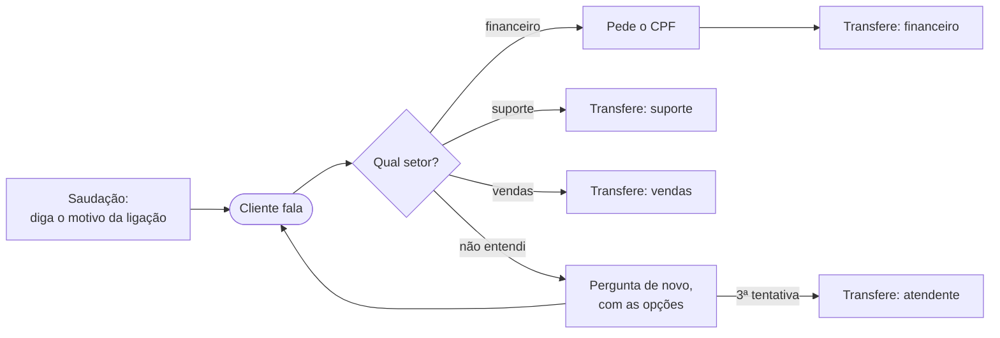

# Tutorial: URA por voz

Uma URA tradicional pede "digite 1 para financeiro, 2 para suporte". Uma URA por voz pergunta o motivo da ligação e entende a resposta do jeito que o cliente fala: "quero a segunda via do boleto", "minha internet caiu", "queria ver os planos". Em seguida, transfere para o setor certo.

Este tutorial monta a URA de [`examples/ura.py`](../../examples/ura.py), passo a passo, e depois mostra variações comuns: horário de funcionamento, submenus e IA para o que não tem setor. Para a configuração básica (Twilio, voz, ruído), veja o [tutorial do atendente](atendente.md); aqui o foco é o que muda numa URA.

## O que vamos construir



Uma URA vive quase toda da **camada 2** (respostas pré-definidas): o que o agente fala e para onde transfere é sempre igual. Não precisa de IA.

## 1. Os setores são intenções

Liste os setores como intenções da sessão. Cada `Decision` já chega com o setor escolhido, sem chamada extra:

```python
from ermis import CustomIntent

SETORES = [
    CustomIntent("financeiro", "Financeiro", "Boleto, segunda via, fatura, pagamento, cobrança, reembolso"),
    CustomIntent("suporte", "Suporte técnico", "Algo não funciona: internet, aplicativo, aparelho, acesso, senha"),
    CustomIntent("vendas", "Vendas", "Contratar, comprar, conhecer planos e preços, mudar de plano"),
]
```

A `description` é o que mais pesa na escolha. Escreva-a com as palavras que o **cliente** usa ("segunda via", "minha internet caiu"), não com os nomes internos dos setores. São até 20 intenções por sessão.

Para cada setor, guarde o aviso que o agente fala e o número para onde transferir:

```python
NUMEROS = {
    "financeiro": "+5511900000001",
    "suporte": "+5511900000002",
    "vendas": "+5511900000003",
    "atendente": "+5511900000000",
}
AVISOS = {
    "financeiro": "Certo, vou transferir você para o financeiro.",
    "suporte": "Entendi, vou transferir você para o suporte técnico.",
    "vendas": "Ótimo! Vou transferir você para o time de vendas.",
    "atendente": "Vou transferir você para um atendente.",
}
```

## 2. Uma saudação que ensina o que dizer

O cliente está acostumado a esperar um menu. Diga que ele pode falar livremente e dê exemplos:

```python
SAUDACAO = (
    "Olá, você ligou para a Empresa Exemplo. Em poucas palavras, diga o motivo da sua ligação. "
    "Por exemplo: segunda via, suporte técnico ou falar com vendas."
)
```

Os exemplos fazem o cliente responder curto e com as palavras que a URA reconhece melhor.

## 3. Priorize a latência

Numa URA, a resposta do cliente é curta e o agente só precisa do setor. Responder rápido importa mais do que acertar cada palavra:

```python
session = await ermis.sessions.create(
    transport="twilio",
    voice="Sarah",
    transcription_priority="latency",   # o texto sai assim que o reconhecimento rápido termina
    custom_intents=SETORES,             # cada Decision já traz o setor em custom_intent
    metadata={"call_sid": CallSid, "fluxo": "ura"},
)
```

Se o seu público dita números longos na URA (contrato, protocolo), não aumente o silêncio da sessão inteira: peça só aquele dado com `expect_slot` (passo 5).

## 4. Escolha o setor e transfira

O laço da conversa olha a intenção de cada fala:

```python
setor = event.business_intent()   # o setor, ou "other" quando a escolha não é segura
if setor in ("suporte", "vendas"):
    await encaminhar(setor)
elif setor == "financeiro":
    ...                            # passo 5: pede o CPF antes
else:
    tentativas += 1
    if tentativas > MAX_TENTATIVAS:
        await encaminhar("atendente")
    else:
        await call.speak("Não entendi o assunto. É sobre financeiro, suporte técnico ou vendas?")
```

- `business_intent()` só devolve um setor quando a escolha é segura (confiança de 0,8 ou mais). Abaixo disso, devolve `"other"`, e a URA pergunta de novo, agora com as opções, em vez de transferir para o setor errado.
- Depois de algumas tentativas (`MAX_TENTATIVAS = 2`), a ligação vai para um atendente. Nunca deixe o cliente preso num laço.
- Fala confusa (`event.unclear`) pede repetição antes de qualquer outra coisa:

  ```python
  if event.unclear:
      await call.speak("Desculpe, não entendi. Pode repetir?")
      continue
  ```

`encaminhar()` fala o aviso sem permitir interrupção e marca o destino:

```python
async def encaminhar(setor: str) -> None:
    nonlocal destino
    destino = setor
    await call.speak(AVISOS[setor], allow_barge_in=False)
```

A transferência só acontece **depois** que o aviso termina, para o cliente ouvir para onde vai:

```python
elif isinstance(event, SpeakDone) and destino is not None:
    if destino != "fim":
        await transferir(call_sid, destino, dados)
    await call.end()
```

No Twilio, transferir é trocar o TwiML da ligação por um `<Dial>`. A sessão da Ermis termina sozinha:

```python
from twilio.rest import Client   # pip install twilio

async def transferir(call_sid: str, setor: str, dados: dict[str, str]) -> None:
    Client().calls(call_sid).update(twiml=f"<Response><Dial>{NUMEROS[setor]}</Dial></Response>")
```

## 5. Peça os dados antes de transferir

Pedir um dado na URA poupa tempo do atendente: o financeiro já recebe a ligação sabendo de quem é. Faça a pergunta e avise que a próxima resposta traz um CPF. A Ermis lê essa resposta também com o reconhecimento de maior precisão, em segundo plano, sem atrasar a conversa:

```python
if setor == "financeiro":
    etapa = "cpf"
    await call.speak("Para agilizar, qual é o CPF do titular?")
    cpf_esperado = await call.expect_slot("cpf", "cpf")
```

Na `Decision` da resposta, pegue o valor:

```python
if etapa == "cpf":
    cpf = await cpf_esperado
    if cpf.found:
        dados["cpf"] = cpf.value
    await encaminhar("financeiro")   # com ou sem CPF: o financeiro confirma
```

O CPF vem formatado ("123.456.789-00"), mesmo quando o cliente diz "um dois três, quatro cinco seis...". Envie `dados` para o seu CRM antes de transferir, para o atendente ver na tela quem está ligando.

Outros tipos de dado: `email`, `phone`, `cnpj`, `date`, `number`, `name`, ou `text` com uma `description` (por exemplo, "número do contrato, com 8 dígitos").

## 6. Desistência e pedido de atendente

Duas falas sempre têm a mesma resposta, em qualquer etapa:

```python
if event.is_escape:
    if event.intent == "request_human":     # "quero falar com uma pessoa"
        await encaminhar("atendente")
    else:                                   # "deixa pra lá, tchau"
        destino = "fim"
        await call.speak("Tudo bem. Obrigado pela ligação!", allow_barge_in=False)
    continue
```

## Variações

### Fora do horário de funcionamento

Se não há atendentes, não adianta transferir. Confira o horário antes da saudação:

```python
from datetime import datetime
from zoneinfo import ZoneInfo

def aberto_agora() -> bool:
    agora = datetime.now(ZoneInfo("America/Sao_Paulo"))
    return agora.weekday() < 5 and 8 <= agora.hour < 18   # segunda a sexta, das 8h às 18h

...
if isinstance(event, SessionStarted):
    if not aberto_agora():
        destino = "fim"
        await call.speak(
            "Olá, você ligou para a Empresa Exemplo. Nosso atendimento é de segunda a sexta, das 8h às 18h. "
            "A segunda via do boleto também está no aplicativo. Até logo!",
            allow_barge_in=False,
        )
    else:
        await call.speak(SAUDACAO, calibrate=True)
```

### Submenus

Quando um setor tem filas diferentes, pergunte de novo, agora com as respostas esperadas. A `Decision` da resposta traz a escolhida em `chosen()`, mesmo dita de outro jeito:

```python
SUPORTE = [
    CustomIntent("internet", "internet", "wi-fi, conexão, lentidão, modem"),
    CustomIntent("tv", "TV", "canais, decodificador, controle"),
    CustomIntent("telefone", "telefone fixo", "linha, sem sinal de discagem"),
]

if setor == "suporte":
    etapa = "suporte"
    await call.ask("É sobre internet, TV ou telefone fixo?", choices=SUPORTE)
...
if etapa == "suporte":
    fila = event.chosen()          # "internet", "tv", "telefone", ou None se não for seguro
```

Pergunte com `ask`, não com `speak`: com o `guard` ligado, a Ermis repete essa pergunta sozinha depois de uma fala confusa (veja a [camada 1](atendente.md#71-camada-1-a-ermis-cuida-sozinha)).

### Respostas sem transferência

Algumas ligações não precisam de um atendente: o horário da loja, o endereço, onde baixar o boleto. Inclua essas perguntas como intenções e responda com uma frase pronta, como no [atendente](atendente.md#72-camada-2-respostas-pré-definidas-e-ura). Cada uma delas é uma ligação a menos na fila.

### IA para o que não tem setor

Se muitas ligações caem em "não entendi o assunto", em vez de perguntar de novo, mande a fala para a sua IA externa (camada 3), com a lista dos setores no prompt. Veja [Camada 3: a sua IA](atendente.md#73-camada-3-a-sua-ia).

## Teste

Os testes `test_ivr_routes_finance_with_cpf` e `test_ivr_falls_back_to_an_agent` em [`tests/test_example_flows.py`](../../tests/test_example_flows.py) rodam a URA contra uma Voice API simulada: um cliente que pede a segunda via e dita o CPF, e outro que não é entendido três vezes.

```bash
python -m pytest tests/test_example_flows.py -q -k ivr
```

Depois, ligue para o número com pedidos reais do seu público. Se uma frase comum cai no setor errado, ou em "não entendi", acrescente as palavras dela à `description` do setor certo.
