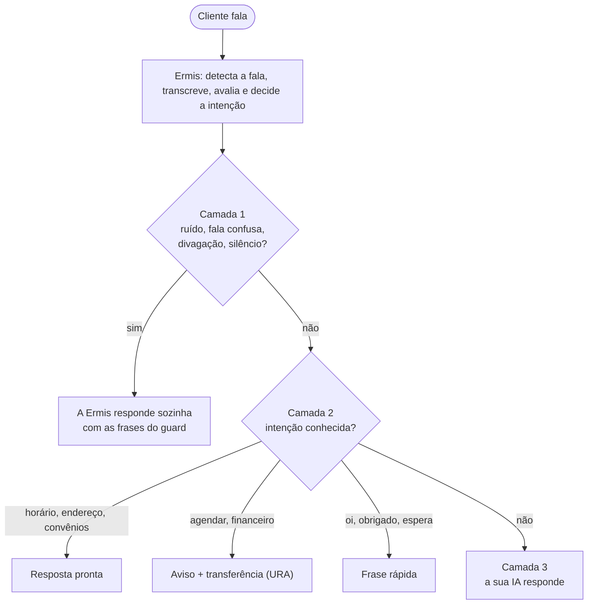

# Tutorial: configure um atendente ou uma URA por voz, passo a passo

Este tutorial monta, do zero, o atendente de uma clínica fictícia: a **Lia**, da **Clínica Bem Estar**. Ela atende por telefone (Twilio) ou por um botão no site e responde sozinha às perguntas frequentes. Se o cliente quer agendar ou falar do financeiro, ela transfere a ligação, como uma URA por voz. As dúvidas abertas vão para a sua IA. Cada passo acrescenta uma parte da configuração. O resultado completo está em [`examples/clinica.py`](../examples/clinica.py).

Se você ainda não ouviu o agente nenhuma vez, faça antes os passos 1 a 3 de [Primeiros passos](primeiros-passos.md), que levam uns 10 minutos.

| Passo | O que você configura |
|---|---|
| [1. Ambiente e chave](#1-ambiente-e-chave) | Python, SDK, chave e URL |
| [2. Canal: Twilio ou navegador](#2-canal-twilio-ou-navegador) | Por onde o áudio do cliente chega |
| [3. Identidade do agente](#3-identidade-do-agente) | Nome, voz, idioma e saudação |
| [4. Calibragem de ruído](#4-calibragem-de-ruído) | Medição do ruído de fundo, interrupções e ambiente barulhento |
| [5. Qualidade e latência](#5-qualidade-e-latência) | O equilíbrio entre responder rápido e entender cada palavra |
| [6. Mensagens de espera](#6-mensagens-de-espera) | O que o cliente ouve enquanto a resposta não chega |
| [7. As três camadas de resposta](#7-as-três-camadas-de-resposta) | Quem responde cada fala |
| [7.1 Camada 1: a Ermis cuida sozinha](#71-camada-1-a-ermis-cuida-sozinha) | Fala confusa, divagação, silêncio e ruído (`guard`) |
| [7.2 Camada 2: respostas pré-definidas e URA](#72-camada-2-respostas-pré-definidas-e-ura) | Frases prontas e transferência por setor |
| [7.3 Camada 3: a sua IA](#73-camada-3-a-sua-ia) | O modelo, o prompt do agente e o histórico |
| [8. Encerrar e transferir](#8-encerrar-e-transferir) | Despedida, pedido de atendente e transferência no Twilio |
| [9. Teste e ajuste](#9-teste-e-ajuste) | Testes sem telefone, ligações reais e o que ajustar |

## Visão geral



Quanto mais falas a camada 1 e a camada 2 resolvem, mais rápido e previsível fica o atendimento. A IA, na camada 3, só recebe o que sobra.

## 1. Ambiente e chave

```bash
python --version                  # 3.10 ou mais novo
pip install ermis-voice fastapi uvicorn python-multipart
export ERMIS_API_KEY="..."        # chave do Ermis Voice: ek_test_… (Sandbox) ou ek_live_… (produção)
export ERMIS_API_URL="..."        # URL do Ermis Voice (durante a prévia, entregue pela equipe da Ermis)
```

A chave fica **só no servidor**: nunca no navegador, no aplicativo ou no repositório. `Ermis()` lê as duas variáveis:

```python
from ermis import Ermis

ermis = Ermis()   # lê ERMIS_API_KEY e ERMIS_API_URL
```

Para conferir que a chave funciona e ver o saldo:

```python
print(await ermis.balance())   # {"balance": …, "reserved_credits": …, "available_credits": …}
```

## 2. Canal: Twilio ou navegador

O áudio vai do telefone (ou do navegador) **direto para a Ermis**, sem passar pelo seu servidor. O seu servidor faz duas coisas: cria a sessão e conduz a conversa pelo canal de controle. A conversa é a mesma nos dois canais; muda só como a sessão é criada.

Para não repetir a configuração, a clínica cria todas as sessões numa função só. Os passos seguintes vão preenchendo essa função:

```python
async def criar_sessao(transporte: str, **extras):
    return await ermis.sessions.create(
        transport=transporte,
        # passos 3 a 7: voz, idioma, qualidade, espera, guard, intenções...
        **extras,
    )
```

E cada ligação roda em segundo plano, numa tarefa própria:

```python
async def _rodar(session, call_sid: str = "") -> None:
    async with ermis.connect(session) as call:
        await conduzir(call, call_sid)   # toda a conversa (passo 7)
```

### 2a. Telefone, pelo Twilio

1. Crie uma conta no [Twilio](https://www.twilio.com) e compre um número com voz.
2. Crie o webhook que o Twilio chama quando o número toca. Ele cria a sessão e responde com o TwiML pronto da sessão, que manda o áudio da ligação para a Ermis:

```python
from fastapi import FastAPI, Form, Response

app = FastAPI()

@app.post("/twilio/voz")
async def ligacao_recebida(CallSid: str = Form(...)) -> Response:
    session = await criar_sessao("twilio", metadata={"call_sid": CallSid})
    asyncio.create_task(_rodar(session, CallSid))      # guarde a tarefa, como no exemplo
    return Response(content=session.twiml(), media_type="application/xml")
```

3. Rode o servidor e deixe a porta acessível pela internet com HTTPS (por exemplo, com [ngrok](https://ngrok.com)):

```bash
uvicorn clinica:app --port 8000
ngrok http 8000                   # anote o endereço https://….ngrok-free.app
```

4. No console do Twilio, abra o número e, em **Voice Configuration → A call comes in**, escolha **Webhook**, método `POST`, com a URL `https://….ngrok-free.app/twilio/voz`.
5. Ligue para o número.

Guarde o `CallSid`: é com ele que você transfere a ligação no [passo 8](#8-encerrar-e-transferir).

### 2b. Navegador, com um botão "Ligar" no seu site

O seu backend cria a sessão com `transport="browser"` e entrega ao navegador **só** o endereço do áudio e um token de uso único. A chave de API nunca sai do servidor.

```python
@app.post("/ligar")
async def ligar_pelo_navegador() -> dict[str, str]:
    session = await criar_sessao("browser", audio_format="pcm16_48k")
    asyncio.create_task(_rodar(session))
    return session.browser_credentials()   # {"audio_url": …, "session_token": …}
```

No navegador:

1. Peça o microfone com `echoCancellation: true` (sem isso, o agente ouve a própria voz e se interrompe).
2. Abra `audio_url?session_token=…` e envie o microfone em quadros binários de μ-law 8 kHz de 20 ms (160 bytes).
3. Toque o áudio recebido (PCM16 48 kHz) e descarte a fila ao receber `{"type": "clear"}` (o cliente interrompeu).
4. Ao receber `{"type": "audio.end", "id"}`, responda `{"type": "playback_finished", "id"}` quando aquela fala terminar de tocar.

Detalhes do protocolo em [Conectando o áudio](api.md#conectando-o-áudio). Para só testar a conversa pelo microfone, sem escrever o front-end, use a aba **Ligação** da Área de Teste na plataforma da Ermis.

## 3. Identidade do agente

A identidade do agente é formada por quatro coisas: o **nome**, a **voz**, o **idioma** e a **saudação**. A Voice API não tem um campo "nome do agente": o nome aparece no que o agente fala (a saudação e as frases prontas) e no prompt da sua IA (camada 3). Guarde tudo em constantes, para o nome ser o mesmo em todo lugar:

```python
NOME_AGENTE = "Lia"
EMPRESA = "Clínica Bem Estar"
SAUDACAO = f"Olá! Você ligou para a {EMPRESA}, aqui é a {NOME_AGENTE}. Como posso ajudar?"
DESPEDIDA = "Obrigada pela ligação. Até logo!"
```

**Voz.** Liste as vozes da sua conta e escolha uma com `production=True` (as outras servem só para testes):

```python
for voz in await ermis.voices.list():
    print(voz.id, voz.name, voz.gender, "produção" if voz.production else "só testes", "(padrão)" if voz.default else "")
```

Use o `id` na sessão. Escolha uma voz que combine com o nome: uma voz feminina para a "Lia". Sem `voice`, a sessão usa a voz padrão da conta.

```python
VOZ = "woman"

await ermis.sessions.create(..., voice=VOZ, language="pt-BR")
```

**Escreva como numa tela.** Toda fala passa por `normalize_for_speech()` antes de ir para a voz: "R$ 109,80" vira "cento e nove reais e oitenta centavos", "19h" vira "dezenove horas", e o markdown e os emojis somem. Você não precisa escrever números por extenso.

**Dicas para a saudação:**

- Diga o nome da empresa e o do agente logo de início: o cliente sabe que ligou para o lugar certo.
- Termine com uma pergunta aberta ("Como posso ajudar?") ou, numa URA, com exemplos do que dizer ("Por exemplo: segunda via, suporte ou vendas").
- Avisos obrigatórios ("esta ligação pode ser gravada") vão numa fala com `allow_barge_in=False`, que o cliente não consegue interromper.

## 4. Calibragem de ruído

Uma ligação pode vir de um escritório silencioso ou de um ponto de ônibus. Para a Ermis separar fala de barulho, ela mede o **ruído de fundo** no começo da ligação, enquanto o cliente ouve a saudação. Para isso, a saudação vai com `calibrate=True`:

```python
if isinstance(event, SessionStarted):
    await call.ask(SAUDACAO, calibrate=True)
```

Quando a medição termina, chega o evento `NoiseCalibrated`:

| Campo | Significa |
|---|---|
| `noise_level` | O nível de ruído medido |
| `noise_floor` | O piso de ruído usado para separar fala de barulho |
| `samples` | Quantas amostras foram medidas |
| `noisy` | `True` quando o ambiente está barulhento demais para entender bem o cliente |

Com o ruído medido, há três formas de lidar com um ambiente barulhento:

- **Pedir ao cliente, e seguir.** É o que a clínica faz:

  ```python
  elif isinstance(event, NoiseCalibrated):
      log.info("Ruído de fundo: %s (barulhento: %s)", event.noise_level, event.noisy)
      if event.noisy:
          await call.speak("Estou ouvindo bastante barulho aí. Se puder, fale mais perto do telefone.")
  ```

- **Deixar a Ermis avisar e encerrar.** Com `"too_noisy"` no `guard` ([passo 7.1](#71-camada-1-a-ermis-cuida-sozinha)), a Ermis fala a frase e encerra a ligação (`SessionEnded.reason == "too_noisy"`). Faz sentido quando uma ligação mal entendida custa mais que uma ligação perdida.
- **Só registrar.** Você também recebe `WarningEvent` com `code == "noisy_environment"` uma vez por ligação. Guarde o aviso para analisar depois.

**Interrupções (barge-in).** O cliente pode interromper o agente a qualquer momento: a Ermis para de falar na hora e passa a ouvir. Num ambiente barulhento, um ruído pode parecer uma interrupção. Se o agente para de falar sem motivo, exija mais fala contínua para interromper:

```python
from ermis import BargeInOptions

await ermis.sessions.create(..., barge_in=BargeInOptions(min_speech_ms=300))   # padrão: 150
```

No navegador, a principal causa é o eco: use `echoCancellation: true` e, nos testes, fone de ouvido.

## 5. Qualidade e latência

Cada fala do cliente passa por três etapas: perceber que ele **terminou de falar**, **transcrever** o que ele disse e **responder**. Cada etapa tem um ajuste que troca velocidade por precisão. A clínica guarda três perfis prontos e escolhe um pela variável `PERFIL`:

```python
PERFIS = {
    # URA e respostas curtas: o turno fecha cedo e a transcrição não espera a leitura de maior qualidade
    "rapido": {
        "transcription_priority": "latency",
        "turn_detection": "smart_turn",
        "early_turn": {"speculate": True, "close_on_complete_text": True},
        "vad": {"min_silence_ms": 350},
    },
    # O padrão recomendado: as duas leituras do áudio, a melhor escolhida
    "equilibrado": {
        "transcription_priority": "balanced",
        "turn_detection": "smart_turn",
        "early_turn": {"speculate": True},
    },
    # Público que fala devagar, dita números ou liga de lugares barulhentos
    "preciso": {
        "transcription_priority": "accuracy",
        "turn_detection": "smart_turn",
        "vad": {"min_silence_ms": 700},
        "barge_in": {"min_speech_ms": 300},
    },
}
PERFIL = PERFIS[os.environ.get("PERFIL", "equilibrado")]

await ermis.sessions.create(..., **PERFIL)
```

O que cada ajuste faz:

| Ajuste | Mais rápido | Padrão | Mais preciso |
|---|---|---|---|
| `transcription_priority` | `"latency"`: o texto sai assim que o reconhecimento rápido termina (cerca de 150 ms a menos por fala) | `"balanced"`: espera as duas leituras do áudio e escolhe a melhor | `"accuracy"`: confere as falas duvidosas antes de pedir confirmação (cerca de 0,3 s a mais, só nelas) |
| `vad.min_silence_ms` (silêncio que fecha a fala) | `300` a `350`: fecha mais cedo, mas corta quem faz pausas | `400` | `600` a `800`: espera quem fala devagar ou dita números |
| `turn_detection` | `"smart_turn"`: um modelo percebe que a pessoa terminou e fecha o turno antes do silêncio completo | `"smart_turn"` | `"silence"`: só o silêncio de `min_silence_ms` |
| `early_turn` | `{"speculate": True, "close_on_complete_text": True}`: começa a transcrever já na pausa e fecha o turno quando a frase já é um pedido completo | desligado | desligado |

Outros dois valores, `"local_first"` e `"local_only"`, servem para quando o reconhecimento rápido basta: o primeiro só recorre à leitura de maior qualidade nas falas duvidosas, o segundo nunca recorre.

**Qual escolher:**

- **URA** (o cliente diz o motivo e é transferido): `rapido`. A resposta é curta, e esperar é pior que errar uma palavra.
- **Atendente geral:** `equilibrado`.
- **Agendamento, cadastro, público idoso:** `preciso`.

**Precisão só onde importa.** Em vez de deixar a ligação inteira mais lenta, peça precisão só na resposta que precisa dela:

- Para uma resposta curta que decide o próximo passo (um sabor, um tamanho, uma especialidade), pergunte com `ask(..., precise=True)` ou chame `await call.expect_precise()` depois da pergunta. Essa fala leva alguns décimos de segundo a mais.
- Para um dado ditado (CPF, e-mail, endereço), use `ask(..., slot=("cpf", "cpf"))` ou `expect_slot`: a conversa segue no ritmo normal e o valor, lido com o reconhecimento de maior precisão, chega depois.
- Liste as palavras do seu negócio em `vocabulary`. Se a transcrição sai parecida com uma delas pelo som, o texto já chega corrigido ("dermatolojia" vira "dermatologia"):

  ```python
  VOCABULARIO = ["Bem Estar", "dermatologia", "ortopedia", "Unimed", "Bradesco Saúde", "SulAmérica", "Amil"]
  ```

**A maior parte da espera costuma ser a sua resposta**, não a transcrição. Respostas prontas (camada 2) e respostas curtas da IA (camada 3) pesam mais na latência do que qualquer ajuste desta tabela.

Mais detalhes em [Perguntas frequentes: qualidade e latência](api.md#perguntas-frequentes-qualidade-e-latência).

## 6. Mensagens de espera

Se a resposta demora (a sua IA, uma consulta ao sistema), o cliente não fica no silêncio: a Ermis fala frases de espera sozinha. Você escolhe as frases e quanto tempo esperar:

```python
from ermis import WaitingOptions

ESPERA = WaitingOptions(
    filler_after_ms=900,                       # depois de 0,9 s sem resposta: "Um momento, por favor."
    filler_messages=["Um momento, por favor.", "Só um instante."],
    timeout_ms=20000,                          # depois de 20 s, desiste
    timeout_message="Desculpe, não consegui essa informação agora. Vou te passar para a recepção.",
    timeout_action="apologize",                # ou "end", para encerrar a ligação
)

await ermis.sessions.create(..., waiting=ESPERA)
```

Se você já sabe que um passo vai demorar, avise antes, com uma frase própria: `await call.thinking("Deixa eu verificar isso pra você.")`. Todas as opções estão em [Enquanto a sua IA pensa](api.md#enquanto-a-sua-ia-pensa).

## 7. As três camadas de resposta

A cada fala do cliente, o seu código recebe um `Transcript` (o que ele disse) e logo depois uma `Decision` (o que ele quer). O laço da conversa decide quem responde, da camada mais barata para a mais cara:

```python
async for event in call:
    if isinstance(event, SessionStarted):
        await call.ask(SAUDACAO, calibrate=True)

    elif isinstance(event, Decision):
        if event.handled:                     # camada 1: a Ermis já respondeu
            continue
        intencao = event.business_intent()    # camada 2: uma intenção da clínica?
        if intencao in RESPOSTAS_PRONTAS: ...
        elif intencao in SETORES: ...
        else: ...                             # camada 3: a sua IA
```

### 7.1 Camada 1: a Ermis cuida sozinha

Fala confusa, divagação, cliente calado e ruído não dependem do seu negócio, só das frases que o agente fala. Ligue o `guard` com as frases da clínica, e a Ermis responde a essas falas sem passar pelo seu código:

```python
GUARD = {
    "enabled": True,
    "repeat": "Desculpe, não entendi direito. Pode repetir?",           # fala confusa
    "steer": "Vamos voltar ao seu atendimento?",                        # 2ª fala confusa seguida: volta à pergunta
    "drift": "Entendi! Voltando ao seu atendimento:",                   # divagação
    "off_topic": "",                                                    # vazio: fora do tema vai para a camada 3
    "give_up": "Estou com dificuldade para te entender. Por favor, ligue de novo. Até logo!",
    "no_reply": "Você ainda está aí?",                                  # cliente calado
    "no_reply_give_up": "Como não ouvi resposta, vou encerrar. Ligue de novo quando quiser!",
}

await ermis.sessions.create(..., guard=GUARD)
```

| Situação | O que a Ermis faz | Ajuste |
|---|---|---|
| Fala confusa | Fala `repeat`. Na segunda seguida, fala `steer` e repete a pergunta atual. Na terceira, fala `give_up` e encerra | `max_unclear` (padrão 3); `"on_give_up": "notify"` só avisa em vez de encerrar |
| Divagação (o cliente fala muito sem tocar no assunto) | Fala `drift` e repete a pergunta atual | — |
| Assunto fora do tema | Fala `off_topic` e repete a pergunta atual | `off_topic` vazio: a fala chega ao seu código (a clínica deixa a camada 3 responder) |
| Cliente calado | Depois de `no_reply_ms` (padrão 8 s), fala `no_reply` e repete a pergunta. No segundo silêncio seguido, fala `no_reply_give_up` e encerra | `no_reply_ms` (`0` desliga), `max_no_reply`, `"on_no_reply": "notify"` |
| Ambiente barulhento demais | Com `too_noisy`, fala a frase e encerra depois da calibragem | `too_noisy` |

A **pergunta atual** é a última feita com `call.ask()`. Por isso, faça toda pergunta com `ask`, e use `speak` para as frases que não são perguntas.

No seu código, as falas que a Ermis já respondeu chegam com `handled=True`. Não responda a elas:

```python
elif isinstance(event, Transcript):
    if not event.handled and event.assessment.usable:   # ruído e fala ilegível: a Ermis já cuidou
        historico.append(("cliente", event.text))

elif isinstance(event, Decision) and destino is None:
    if event.handled:                                   # fala confusa ou divagação: a Ermis já respondeu
        continue
```

### 7.2 Camada 2: respostas pré-definidas e URA

As perguntas frequentes e os pedidos de transferência têm sempre a mesma resposta. Para elas, uma frase pronta é mais rápida, mais barata e mais previsível do que qualquer IA.

**1. Liste as intenções do seu negócio** na sessão. Cada `Decision` já chega com a escolhida, sem chamada extra:

```python
from ermis import CustomIntent

INTENCOES = [
    CustomIntent("horario", "Horário de funcionamento", "que horas abre ou fecha, se abre sábado ou feriado"),
    CustomIntent("endereco", "Endereço", "onde fica a clínica, como chegar, estacionamento"),
    CustomIntent("convenios", "Convênios", "quais planos de saúde aceita, se atende particular"),
    CustomIntent("agendar", "Agendamento", "marcar, remarcar ou cancelar consulta ou exame"),
    CustomIntent("financeiro", "Financeiro", "boleto, nota fiscal, reembolso, pagamento, cobrança"),
]

await ermis.sessions.create(..., custom_intents=INTENCOES)
```

Escreva a `description` com as palavras que o cliente usa ("segunda via", "boleto"), não com nomes internos. São até 20 intenções por sessão. Para trocar as intenções no meio da ligação (uma etapa nova), use `await call.set_custom_intents([...])`.

**2. Associe cada intenção a uma resposta:**

```python
RESPOSTAS_PRONTAS = {   # perguntas frequentes
    "horario": "Atendemos de segunda a sexta, das 7h às 19h, e aos sábados das 8h às 12h.",
    "endereco": "Ficamos na Avenida Paulista, 1000, sexto andar, com estacionamento no prédio.",
    "convenios": "Atendemos Unimed, Bradesco Saúde, SulAmérica e Amil, e também particular.",
}
SETORES = {             # URA: aviso e número para transferir
    "agendar": ("Certo, vou te transferir para o agendamento.", "+5511900000001"),
    "financeiro": ("Certo, vou te transferir para o financeiro.", "+5511900000002"),
    "recepcao": ("Vou te transferir para a recepção.", "+5511900000000"),
}
RESPOSTAS_RAPIDAS = {   # intenções gerais que a Ermis já reconhece
    "greeting": "Oi! Em que posso ajudar?",
    "thanks": "Por nada! Posso ajudar em mais alguma coisa?",
    "wait": "Claro, fico aguardando.",
    "repeat": "Claro. Como posso ajudar?",
}
```

**3. Use as respostas no laço:**

```python
intencao = event.business_intent()     # a intenção da clínica, ou "other" se a escolha não é segura
if intencao in RESPOSTAS_PRONTAS:
    await falar(f"{RESPOSTAS_PRONTAS[intencao]} Posso ajudar em mais alguma coisa?")
elif intencao in SETORES:
    await encaminhar(intencao)          # aviso agora; transferência no passo 8
elif event.action == "respond" and event.intent in RESPOSTAS_RAPIDAS:
    await falar(RESPOSTAS_RAPIDAS[event.intent])
else:
    ...                                 # camada 3
```

`business_intent()` só devolve uma intenção sua quando a escolha é segura (confiança de 0,8 ou mais). Abaixo disso, devolve `"other"` e a fala segue para a camada 3, em vez de o agente agir num palpite.

**URA só por voz.** Para uma URA pura, sem IA, troque a camada 3 por uma pergunta de volta ("É sobre agendamento ou financeiro?") e transfira para uma pessoa depois de duas tentativas. É o que faz [`examples/ura.py`](../examples/ura.py), que também pede o CPF antes de transferir para o financeiro.

**Perguntas com respostas esperadas.** Quando o agente faz uma pergunta fechada, diga quais respostas espera. A `Decision` traz a escolhida em `chosen()`, mesmo com a fala mal transcrita ou dita de outro jeito:

```python
await call.ask("Qual especialidade?", precise=True, choices=[
    CustomIntent("clinica_geral", "clínica geral"),
    CustomIntent("dermatologia", "dermatologia", "pele, manchas, acne"),
    CustomIntent("ortopedia", "ortopedia", "ossos, coluna, joelho"),
])
...
especialidade = event.chosen()          # "dermatologia", ou None se não for seguro
```

Para sim ou não, use `event.answer` (`"yes"`, `"no"` ou `None`), não o `intent`.

### 7.3 Camada 3: a sua IA

O que sobrou (dúvidas abertas, perguntas fora do roteiro) vai para a sua IA. A Ermis não escolhe o modelo: você chama o modelo que quiser, no seu servidor, e fala a resposta com `speak`. O exemplo usa o Claude, pelo SDK da Anthropic:

```bash
pip install anthropic
export ANTHROPIC_API_KEY="..."
```

**1. Escreva o prompt do agente.** É aqui que o nome, os fatos do negócio e as regras de uma conversa por voz entram:

```python
PROMPT_IA = f"""Você é {NOME_AGENTE}, atendente virtual da {EMPRESA}, numa ligação telefônica.
Fatos da clínica: {" ".join(RESPOSTAS_PRONTAS.values())}
Especialidades: clínica geral, dermatologia e ortopedia.
Regras:
- Responda em português do Brasil, em uma ou duas frases curtas: o cliente ouve, não lê.
- Sem listas, markdown ou emojis.
- Não invente preços, horários de médicos nem resultados de exame. Se não souber, diga que vai transferir
  para a recepção e termine a resposta com [TRANSFERIR].
- Não dê orientação médica; em caso de urgência, oriente a procurar um pronto-socorro ou ligar 192."""
```

Para um bom prompt de voz:

- **Respostas curtas.** O cliente só pode responder quando o agente termina de falar. Uma ou duas frases.
- **Os fatos vêm do seu sistema**, não da memória do modelo. Reaproveite as respostas da camada 2, para as duas camadas dizerem a mesma coisa.
- **Uma saída para o que a IA não sabe.** Aqui, a marca `[TRANSFERIR]`, que o código troca por uma transferência para a recepção.
- **Nada de formatação.** A normalização da voz já remove markdown, mas a IA não deve contar com listas para se fazer entender.

**2. Mande o histórico e fale a resposta:**

```python
import anthropic

async def responder_com_ia(historico: list[tuple[str, str]]) -> str:
    mensagens = [
        {"role": "user" if quem == "cliente" else "assistant", "content": texto} for quem, texto in historico
    ]
    while mensagens and mensagens[0]["role"] != "user":   # a conversa da IA começa pela fala do cliente
        mensagens.pop(0)
    resposta = await anthropic.AsyncAnthropic().beta.messages.create(
        model="claude-opus-5-5",
        max_tokens=1024,
        output_config={"effort": "low"},          # respostas curtas de atendimento: menos espera
        betas=["server-side-fallback-2026-07-01"],
        fallbacks="default",                      # se o modelo recusar, outro modelo responde na mesma chamada
        system=PROMPT_IA,
        messages=mensagens,
    )
    if resposta.stop_reason == "refusal":
        return "Essa eu prefiro confirmar com a recepção. [TRANSFERIR]"
    return next((b.text for b in resposta.content if b.type == "text"), "").strip()
```

No laço:

```python
else:
    if event.complexity >= 2:                    # problema, reclamação, pedido de ação
        await call.thinking("Deixa eu verificar isso pra você.")
    resposta = await responder_com_ia(historico)
    if "[TRANSFERIR]" in resposta:
        await falar(resposta.replace("[TRANSFERIR]", "").strip())
        destino = "recepcao"                     # transfere depois desta fala (passo 8)
    else:
        await falar(resposta)
```

O histórico é a lista de falas montada no laço: a função `falar()` guarda cada fala do agente, e o `Transcript` guarda cada fala aproveitável do cliente.

**Latência da IA.** O modelo é a parte mais lenta da conversa. O `effort="low"` e as respostas curtas ajudam. Se ainda assim demorar, o cliente ouve as mensagens de espera do [passo 6](#6-mensagens-de-espera), e o `timeout_ms` limita a espera. Meça com ligações reais antes de trocar de modelo.

**Outra IA.** Qualquer modelo serve: troque o corpo de `responder_com_ia()` pela chamada do seu provedor. O resto do código não muda.

## 8. Encerrar e transferir

Toda ligação precisa terminar: com uma despedida seguida de `end()`, ou com uma transferência.

**Despedida e pedido de atendente.** Use `is_escape`, não o texto da fala (a transcrição pode vir como "Tchau.", "valeu, tchau!" ou "tchau tchau"):

```python
if event.is_escape:
    if event.intent == "request_human":
        await encaminhar("recepcao")                       # "quero falar com uma pessoa"
    else:
        destino = "fim"
        await falar(DESPEDIDA, allow_barge_in=False)       # "tchau", "era só isso"
    continue
```

**Espere a última fala terminar** antes de transferir ou encerrar, senão o cliente não ouve o aviso:

```python
elif isinstance(event, SpeakDone) and destino is not None:
    if destino != "fim":
        await transferir(call_sid, SETORES[destino][1])
    await call.end()
```

**A transferência no Twilio.** Troque o TwiML da ligação por um `<Dial>`. A sessão da Ermis termina sozinha:

```python
from twilio.rest import Client   # pip install twilio

async def transferir(call_sid: str, numero: str) -> None:
    Client().calls(call_sid).update(twiml=f"<Response><Dial>{numero}</Dial></Response>")
```

Os dados que o agente coletou (nome, CPF, motivo) podem ir para o seu CRM antes da transferência, para quem atender já saber do que se trata. No navegador não há transferência de ligação: encerre com uma orientação (o telefone da recepção, um link de agendamento).

**Limite de duração.** `max_duration_s` (a clínica usa 900, ou seja, 15 minutos) encerra ligações esquecidas abertas. O tempo é cobrado enquanto a sessão está aberta.

## 9. Teste e ajuste

**Sem telefone.** O laço da conversa (`conduzir`) recebe o `Call` de qualquer canal de controle. Os testes de [`tests/test_example_flows.py`](../tests/test_example_flows.py) usam uma Voice API simulada, que faz o papel do cliente: troque as falas do roteiro e confira o que o agente respondeu. Os testes da clínica conferem as três camadas: a resposta pronta, a pergunta que vai para a IA e a transferência.

```bash
pip install -e ".[dev]"
python -m pytest tests/test_example_flows.py -q
```

**Com o seu áudio.** [`examples/primeira_ligacao.py`](../examples/primeira_ligacao.py) envia uma fala gravada em WAV e salva a resposta do agente, sem Twilio nem navegador.

**Com ligações reais.** Ligue de um celular, num lugar silencioso e num lugar barulhento, falando rápido e devagar. Registre os eventos `Transcript` (o que foi entendido), `NoiseCalibrated`, `WarningEvent` e `SessionEnded` (o motivo do fim), e ajuste:

| Sintoma | Ajuste |
|---|---|
| O agente demora para responder | Perfil `rapido`; mais respostas na camada 2; respostas mais curtas da IA |
| O cliente é cortado no meio da frase | Aumente `vad.min_silence_ms` (600 a 800) |
| O agente para de falar por qualquer barulho | Aumente `barge_in.min_speech_ms` (300); no navegador, `echoCancellation` |
| Nomes de produtos ou de médicos saem errados | Coloque as palavras em `vocabulary` |
| CPF, e-mail ou endereço saem errados | Pergunte com `ask(..., slot=...)` e confirme antes de gravar |
| A intenção errada é escolhida | Melhore a `description` das intenções com as palavras do cliente; confira `custom_intent_confidence` |
| A IA inventa informações | Coloque os fatos no prompt e dê a ela a saída `[TRANSFERIR]` |
| Muitas ligações terminam em `too_noisy` | Tire o `too_noisy` do `guard` e peça ao cliente para falar mais perto do telefone |

Antes de ir para produção, passe pela [lista de conferência](primeiros-passos.md#8-antes-de-ir-para-produção).

## O resultado

O exemplo [`examples/clinica.py`](../examples/clinica.py) junta todos os passos:

```bash
pip install ermis-voice fastapi uvicorn python-multipart anthropic
export ERMIS_API_KEY=... ERMIS_API_URL=... ANTHROPIC_API_KEY=...
export PERFIL=equilibrado          # rapido, equilibrado ou preciso
uvicorn clinica:app --port 8000
```

Para adaptar ao seu negócio, troque as constantes do começo do arquivo: o nome, a voz, a saudação, as intenções, as respostas prontas, os setores e o prompt da IA. O laço da conversa continua o mesmo.

Outros exemplos com a mesma estrutura: [`agendamento.py`](../examples/agendamento.py) (marcar, remarcar e cancelar, com confirmação), [`ura.py`](../examples/ura.py) (URA sem IA, com CPF) e [`pizzaria.py`](../examples/pizzaria.py) (pedido por etapas, com `ask`, `choices` e endereço lido pelo reconhecimento preciso).
